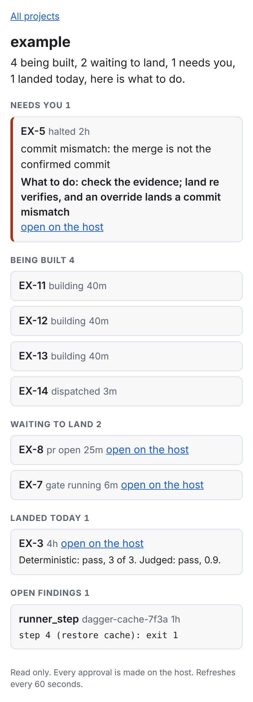
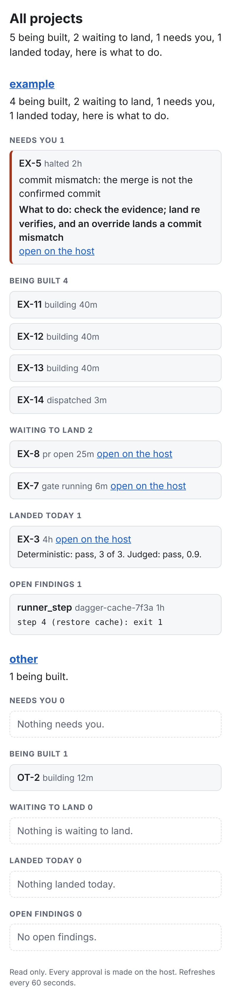

# U20 explainer: the status page

The status page is the operator's read only view of every card Slipway is working on. It answers one question in the ideation note's words, "4 being built, 2 waiting to land, 1 needs you, here is what to do", and then shows each card under its group with the link into the host where anything is approved. It holds no state of its own and makes no decision: every fact comes from `service.status`, the same composed status the MCP tools and the CLI read (KTD23).

## Words used below

- **WSGI.** The standard interface between a Python web application and the server that runs it. `Page` is a WSGI application, so any WSGI server can serve it.
- **Server rendered.** The HTML is built on the server for each request; the browser runs no script. A meta refresh tag reloads the page every minute.
- **OAuth subject.** The stable user id the identity provider puts in a token. The operator file names the operator's own.
- **Authorization code flow.** The login where the browser goes to the identity provider, comes back with a one time code, and the server trades that code for tokens directly with the provider.
- **PKCE.** Proof key for code exchange: a random secret, the verifier, whose hash goes out with the browser and whose plain value goes out only with the code, so a code stolen on the way back is useless alone.
- **OpenID Connect.** The login layer on top of OAuth: the provider publishes its endpoints at a discovery address and returns an ID token naming who signed in.
- **Content security policy.** A response header that tells the browser what the page may load or do; this one allows no script, no frame, and no form post.
- **ID token.** The token in which the provider names who signed in, with their subject, the client it is for, and when it expires.
- **TLS.** The encryption under https: the server proves who it is with a certificate the client checks, so a reply cannot be forged or read on the way.
- **HMAC.** A keyed hash. Only the holder of the key can make a value that checks, so a cookie signed with it cannot be forged or edited.
- **Age.** How long a card has been in its current state, such as `40m` or `2h`.
- **Finding.** A fault Slipway saw in a gate run that is not the card's own, such as a runner step that failed (KTD20).

## What each file does

| File | What it does |
|:-|:-|
| `src/slipway/page/app.py` | The WSGI application. It routes four paths, checks the session on every view, and renders `status.compose` or `status.across` through the templates, escaping every value. |
| `src/slipway/page/login.py` | The login: the PKCE pair, the HMAC cookie signer, and `OidcIdentity`, which speaks OpenID Connect to the provider the operator file names. |
| `src/slipway/page/templates/*.html` | The page's pieces as `string.Template` files: the layout with its styles, one project, every project, one group, and one row of each kind. |
| `src/slipway/service/status.py` | `compose` now also returns each card's age, the cards that landed today with both scores, and the open findings, and it drops an abandoned card once the card has left the ready status. |
| `src/slipway/service/verbs.py` | The `Records` interface gains `scores` and `open_findings`, and `PostgresRecords` answers them. |
| `tests/unit/test_page.py` | The card's scenarios, the login, escaping, and the ID token checks, on fixture records. |
| `tests/_service_fakes.py` | The in memory records gain scores and findings. |
| `tests/integration/test_service_records.py` | The new reads through Postgres. |

## The paths

| Path | Who | What happens |
|:-|:-|:-|
| `GET /` | the operator | Every project under the totals (`status.across`). |
| `GET /projects/<slug>` | the operator | One project (`status.compose`). An unknown slug is not found; the slug must be one `ports.slugs()` lists, so a path can never reach another file. |
| `GET /login` | anyone | Sends the browser to the provider. |
| `GET /callback` | anyone | Where the provider sends the browser back. |
| any other method | anyone | 405, with `Allow: GET`. |

With no valid session a view redirects to `/login`, which comes back to the same view. A session whose subject is not the operator's gets 403 on both views, whatever the provider said.

## How a view is drawn

Each project shows five groups, needs you first:

1. **Needs you.** State, age, the line that says why, what to do, and the host link.
2. **Being built.** Key, state, and age.
3. **Waiting to land.** Key, state, age, and the host link.
4. **Landed today.** Key, age, host link, and both scores: the deterministic one (U16) and the judged one (U17), each "not scored yet" until it is written.
5. **Open findings.** Class, fingerprint, age, and the scrubbed log excerpt.

The across view is the same project template once per project, under a headline built from the totals and a list of any project file that could not be read. Every state belongs to one group, from the `states` table, so a card appears exactly once.

The headline is `status.spoken` over the counts, with "here is what to do" in place of the full stop when something needs you.

## Login, step by step

1. `/login` makes a PKCE verifier, a state, and a nonce, and signs all three with the return path into a login cookie that lives ten minutes. It sends the browser to the provider's authorization endpoint with the challenge.
2. `/callback` reads the login cookie, checks the returned state against it, and calls the provider's token endpoint with the code and the verifier.
3. The ID token comes straight back from the token endpoint over TLS, so the TLS check stands in for its signature, as OpenID Connect Core 3.1.3.7 allows. The issuer, audience, expiry, nonce, and subject are still checked.
4. Only the operator's subject gets a session cookie, signed and lasting twelve hours. Any other subject gets 403 and no cookie.

Both cookies are HttpOnly (no script can read them), SameSite Lax (another site cannot send them on a post), and Secure when the page is served over https. The redirect address the provider is told is built from the configured base URL, never from the request's Host header.

## Why the page cannot approve anything

There is no form in any template, the page accepts only GET, and every response carries a content security policy with `form-action 'none'` and no script source. The test reads every template for a form, a method, a script, or the word approve.

## The abandoned rule

The plan's states table says an abandoned card is shown once, then dropped when the card leaves the ready status. `compose` reads the tracker for that one fact, and only for cards whose latest build is abandoned, so a status read stays cheap. A card still in the project's ready status is shown under needs you; one moved off it is dropped from the counts and every list. When the tracker cannot be read the card stays, since hiding it would hide work. The read is not cached: an abandoned card leaves the list as soon as it is dispatched again or moved off the ready status, so there are rarely more than a few, and one tracker read each per page load is well inside a tracker's rate limit. A cache would add shared state to a stateless page and keep a dropped card on screen after the person moved it.

## Where this departs from the card, and why

- **`auth.py` does not exist yet.** The card says the login runs against the identity provider in `auth.py`; that file is U3 and U18's, and neither has landed. The login lives in `page/login.py` instead, reading the provider from the operator file. When U18 writes the shared verifier, the provider calls can move there.
- **Files outside the card's list.** `page/__init__.py` and `page/login.py` are new parts of the page. `service/status.py`, `service/verbs.py`, and their fakes and integration test carry the age, scores, findings, and abandoned rule, because the conductor's rule is that the page adds no status logic. `pyproject.toml` ships the templates in the package. The screenshots live under `docs/explainers/images/`.
- **Serving it.** `Page` takes its ports, its identity provider, a session key, and its base URL. Which process serves it on the VPS, and the environment variables for the key and the URL, are deploy wiring for `deploy/`, outside this card.
- **The live login needs a smoke.** The tests drive a fake provider. The first sign in against the real provider is the operator's to run once the page is deployed.

## Screenshots at phone width

One project, 390 pixels wide:

Every project:

