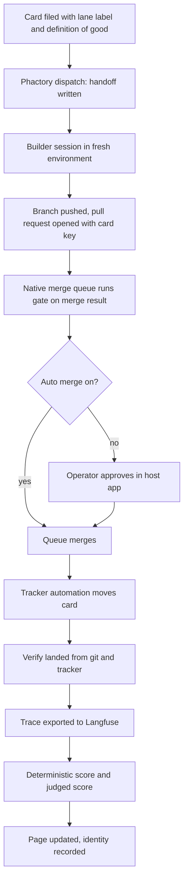

# Phactory First Version - Plan

## Goal Capsule

- **Objective:** A one person product engineering consultancy can file a card on any customer's tracker from a phone, have it built off the laptop by whichever builder the project allows, landed through one trusted merge path, scored against a written definition of good, and shown on one page, with nothing project specific inside the tool.
- **Means:** A thin, hosted, durable workflow that wires existing services (builder APIs, native merge queues, a trace store, tracker automation) into one loop and owns only what no vendor sells: the handoff, project knowledge, verify landed, the evals, in flight facts, the page, and an agent callable verb surface.
- **Product authority:** Phillip Gutowski, sole operator. Manager agents, voice bots, further builder adapters, and multi operator tenancy are later areas and not active scope.
- **Open blockers:** None before planning. Three spikes gate the first build unit and are listed under Outstanding Questions.

---

## Product Contract

### Summary

Phactory is the landing and grading authority between any coding agent builder and a customer's repository. It takes labelled cards, hands each to a builder through one fixed handoff, pushes the returned branch as a pull request into the host's native merge queue, verifies from git and the tracker that the card landed, stores the trace in Langfuse, scores the result two ways, records who did each step, and exposes every verb to agents over a remote MCP server with per project scoped access. The first version drives Claude Managed Agents and a headless CLI builder in a sandbox or on the laptop, speaks GitHub with Projects and Bitbucket Cloud with Jira, and onboards a project through a guided one question at a time intake.

### Problem Frame

Phillip runs several projects, his own boards and Integrel's support-workbench, through two home grown build systems. The Relay runner holds about twenty thousand lines and two thousand tests and has never scored a result. The board lanes script lands branches well but knows one board, one macOS machine, and one terminal. Both put the laptop in the critical path: laptop closed, nothing dispatches, lands, or grades.

He is building a product engineering consultancy. Each customer brings a repository on a different host with a different tracker, and the customer's work has to flow through one path he trusts, off his machine, with a record he can show. Vendors now sell the building (Claude Managed Agents, Cursor Cloud Agents, Devin, Grok Build) and will add grading inside their own loops. None of them owns the repo side across builders: verifying a card actually landed, scoring any builder on the customer's rubric, holding the project's gate truth, and showing one page across every builder and project. That layer is the asset, and it does not exist yet.

### Key Decisions

- **Phactory does not build; builders are adapters behind one handoff, and the headless CLI builder is Phactory's own.** (session-settled: user-directed, chosen over every builder as an adapter: the CLI lane is what consumes subscription accounts and serves machine bound tasks.) Governs R9, R10, R11, R12.
- **Outcome parity with the runner and the lanes script, not feature parity.** (session-settled: user-approved, chosen over carrying every verb and process: the note's exclusions stand and the harness stays thin.) Governs R1, R2.
- **The whole first version is one contract.** (session-settled: user-directed, chosen over a replay eval only slice, a dispatch only slice, or an onboarding only slice: one dialogue, a multi unit plan built from a card queue.)
- **The control plane is hosted and unattended; the laptop is one optional builder.** (session-settled: user-approved, chosen over laptop first with host as config: the laptop was the bottleneck to remove.) Governs R4, R5, R6.
- **Landing is pull request first through the host's native merge queue; Phactory never merges.** (session-settled: user-directed, chosen over a standing go per project and over every push waiting: pushing is automatic, a person approves the pull request, auto merge is a per project option.) Governs R17, R18, R19, R20.
- **The control loop is a workflow definition on a durable engine, not a runner with a state file.** (session-settled: user-approved, chosen over a hand written loop: hours long waits with approval steps and resume are what engines do, and the state file loop is where the old runner's size came from.) Governs R4, R7.
- **Traces live in Langfuse over OpenTelemetry; Phactory builds no trace folder or dashboard.** (session-settled: user-approved, chosen over a per task trace folder: open source, self hostable, runs rubric judges, free at one person scale.) Governs R21, R22, R23.
- **Claude Managed Agents is the first hosted builder; Cursor Cloud Agents and Grok Build are the next adapters, Devin is not yet.** (session-settled: user-directed, chosen over all three hosted vendors in the first version and over Devin now: Managed Agents has a session API and a full event log, Devin is not in use yet.) Governs R9, R11.
- **The surface is any MCP client; Grok, the Claude app, and a Claude Code session are the known three.** (session-settled: user-directed, chosen over the Claude app alone: one grokbot per customer is a surface Phillip wants available, and nothing in the xAI suite invalidates Phactory.) Governs R25, R26, R27.
- **Manager agents are configured, not built, in the first version.** (session-settled: user-approved, chosen over shipping a conversational orchestrator with or without voice: the orchestrator is a client of the verbs, and no product sells it yet.) Governs R25, R28.
- **One operator, with identity recorded on every step and per project scoped tokens.** (session-settled: user-directed, chosen over multi operator tenancy from day one: tenancy later becomes a permission model over records that already exist.) Governs R8, R27.
- **Accounts may be consumer subscriptions as well as API keys, and may be pooled across projects.** (session-settled: user-directed, chosen over API accounts only: Phillip checked the terms and allows it.) Governs R13, R14, R15.
- **The eval runs after landing and is informational.** Carried from the ideation note. Governs R24.
- **Phactory never writes the tracker.** Carried from the ideation note. The manager agent files cards and the tracker's own automation moves them. Governs R3, R20.
- **Project agnostic is the first law.** Carried from the ideation note. Nothing project specific is code in the tool. Governs R1, R29, R30.

### Actors

- A1. **Operator.** Phillip. Onboards projects, holds accounts, approves pull requests, reads the page, writes definitions of good.
- A2. **Manager agent.** A Grok bot, a Claude app project, or a Claude Code session, one per customer project. Talks to the operator, files cards, drives Phactory's verbs, reads status. Outside Phactory.
- A3. **Builder.** A Claude Managed Agents session or a headless CLI session in a sandbox or on the laptop. Receives a handoff, returns a branch.
- A4. **Host and tracker.** GitHub with Projects, or Bitbucket Cloud with Jira. Runs the merge queue and the gate, moves the card on merge.
- A5. **Phactory.** The hosted workflow that dispatches, verifies, traces, scores, records, and serves the page and the verbs.

### Requirements

**Project agnosticism and onboarding**

- R1. Phactory carries no knowledge of any one project; every project specific value is configuration the project supplies outside any repository.
- R2. One configuration file per project names the repository, host, tracker, board, lane label, gate command, allowed builders, accounts per role, model and effort per role, auto merge setting, per project build cap, and where the project keeps its evals.
- R3. One configuration file per operator names the accounts the operator holds, each as a subscription login or an API key, and never appears in a project file.
- R29. The onboard verb runs a guided intake that asks one question at a time, offers choices wherever a choice exists, and ends with a working project file.
- R30. Onboard checks the four properties, independent tasks, durable state between tasks, an external gate that refuses broken changes, and a written definition of verification, and for each failing property it states what is missing and offers the fix as the next single step.
- R31. Onboard finishes by landing one trivial card end to end, so the first real card is not the first test.
- R32. Onboard re entered on an existing project asks only the questions whose answers are missing or no longer true.
- R33. Onboard runs identically as a terminal wizard and through the MCP server, so a manager agent can onboard a customer from a phone conversation.

**Control plane**

- R4. Phactory runs on a host the operator does not have to keep awake, as a durable workflow whose every step resumes after a failure.
- R5. Phactory keeps many builds in flight per project up to the project's cap, with landing serialised per repository by the host's merge queue.
- R6. Nothing in the control plane depends on the laptop except builds a project declares machine bound.
- R7. Phactory halts a card, never continues past it, when it cannot confirm an outcome from git or the tracker, and the page shows the halt with its evidence.
- R8. Every dispatch, approval, landing, and score records which operator or agent caused it.

**Dispatch and builders**

- R9. A card carries its lane from the moment it is filed, by a label chosen from a few plain words, and Phactory dispatches only cards that carry one.
- R10. Every builder receives the same handoff: base commit, branch name, the project's rules, the files other in flight builds are editing, and the done line, and returns a branch at a commit.
- R11. The builder adapter contract is written against six primitives, harness, environment, tools, skills, credentials, and schedule, so a Managed Agents session, a Cursor Cloud Agent, a Grok Build run, or a headless CLI session fits without changing the contract.
- R12. Every build runs in a fresh environment; nothing carries between cards except what landed in git and on the tracker.
- R13. A project binds each role, builder, judge, and any helper, to one account from the operator file and one model and effort.
- R14. A subscription account is consumed by a headless CLI session logged in as that account in a sandbox Phactory controls or on the laptop; an API key account is consumed by the provider's session API.
- R15. Every task records the account, model, and cost or token usage it consumed, visible per project and per customer.
- R16. A remote builder reads nothing on the operator's machine; the handoff carries every rule it needs, including which tests are machine bound.

**Landing**

- R17. Phactory pushes each returned branch and opens one pull request per card, titled with the card's key, into the host's native merge queue.
- R18. The gate is the project's own CI run by the merge queue on the merge result, plus Phactory's deterministic checks, and Phactory never runs a merge itself.
- R19. A pull request merges when a person approves it in the host, or automatically when the project has auto merge on, and Phactory records which.
- R20. Verify landed reads git and the tracker only: the merged commit equals the commit the gate tested, and the card moved by the tracker's own automation. A builder's claim is never evidence.

**Trace and eval**

- R21. Every task exports the builder's full event log, every tool call, file change, command, and outside connection, to Langfuse as one trace.
- R22. When a provider cannot return its event log after a session ends, the builder commits its own action log to the branch and the trace is built from that.
- R23. Every task's trace holds the diff or branch so it can be graded later by replay.
- R24. Every landed task gets two scores kept apart: a deterministic score (gate passed, diff inside declared paths, the test the card named exists and runs) and a judged score (a fresh model, given the card's definition of good and the diff, returns a rubric result), recorded against the task's trace.

**Surface and verbs**

- R25. Every verb, onboard, dispatch, status, land, eval, trace, and watch, is callable by an agent through a remote MCP server as well as by a person in a terminal.
- R26. The MCP server authenticates with OAuth using PKCE and dynamic client registration so Grok, the Claude app, and Claude Code can connect.
- R27. An MCP token is scoped to one project; a manager agent for one customer can read nothing of another customer's cards, status, in flight facts, or traces.
- R28. The page shows, per project and across projects, what is being built, what is waiting to land, what needs the operator, and the link into the host where each approval is made; it holds no approval state of its own.

**Trackers and hosts**

- R34. Tracker adapters are read only, lifted from the runner for GitHub and Jira, with Bitbucket Cloud added as the host for Jira projects.
- R35. The three cold onboardings pass with no code change: a GitHub repository with a GitHub Projects board, a Bitbucket Cloud repository with a Jira board, and a project Phactory has never seen.

### Key Flows

- F1. One card, end to end
  - **Trigger:** A manager agent files a card with the lane label and a definition of good.
  - **Actors:** A2, A5, A3, A4, A1
  - **Steps:** Phactory writes the handoff and starts a builder in a fresh environment bound to the project's account. The builder pushes a branch and opens a pull request titled with the card key. The merge queue runs the gate on the merge result. The operator approves in the host app, or the queue merges on green when auto merge is on. Tracker automation moves the card. Phactory verifies from git and the tracker, exports the trace, scores it twice, records who did each step, and updates the page.
  - **Outcome:** The card is done, the commit on main is the one the gate tested, and the scores and trace are readable.
  - **Covered by:** R9, R10, R12, R17, R18, R19, R20, R21, R24, R28

- F2. Onboarding a customer project
  - **Trigger:** The operator or a manager agent runs onboard for a repository Phactory has never seen.
  - **Actors:** A1 or A2, A5
  - **Steps:** One question at a time with choices: host, repository, tracker, board, lane label, gate command, builders, accounts per role, auto merge, cap, evals location. The four properties check runs and each failing property returns one next step with its fix. A trivial card is filed and landed end to end.
  - **Outcome:** A project file exists outside any repository and the first real card can be filed.
  - **Covered by:** R2, R29, R30, R31, R33, R35

- F3. Halt on an unconfirmable outcome
  - **Trigger:** A pull request merged but the card did not move, or the merged commit differs from the tested one.
  - **Actors:** A5, A1
  - **Steps:** Phactory stops that card, records the evidence, and shows it under needs you with the link into the host. The operator repairs by hand and the workflow resumes at verify.
  - **Outcome:** No card is counted landed without both git and the tracker agreeing.
  - **Covered by:** R7, R20, R28

- F4. Swapping a model or an account
  - **Trigger:** The operator edits a project's role binding to a different model, effort, or account.
  - **Actors:** A1, A5
  - **Steps:** The next dispatch uses the new binding. Scores and cost for tasks before and after are visible side by side per project.
  - **Outcome:** The swap is a config edit whose effect is readable in the scores.
  - **Covered by:** R13, R15, R24

### Acceptance Examples

- AE1. **Covers R19, R20.** Given a project with auto merge off and a green gate, when the operator approves the pull request in the Bitbucket app, then the queue merges, Jira moves the card, and Phactory records the landing as approved by the operator with the merged commit equal to the tested commit.
- AE2. **Covers R7, R20.** Given a pull request that merged while the card stayed in progress, when verify runs, then the card is halted with the evidence shown under needs you, and the page does not count it as landed.
- AE3. **Covers R12, R14.** Given a project bound to a subscription account for the builder role, when two cards are dispatched, then two separate CLI sessions run in two fresh environments logged in as that account, and neither sees the other's files.
- AE4. **Covers R27.** Given two customer projects and a Grok bot holding a token for the first, when the bot asks for status, then it receives only the first project's cards, in flight facts, and scores.
- AE5. **Covers R22.** Given a builder whose provider returns no event log after the session ends, when the task lands, then the trace is built from the action log the builder committed to its branch, and the judged score still runs.
- AE6. **Covers R30.** Given a repository with no CI gate, when onboard runs, then it stops at the gate property, says that an external gate that refuses broken changes is missing, and offers adding one as the next single step before any card can be filed.
- AE7. **Covers R24.** Given a landed card whose definition of good names a test, when the deterministic score runs, then it fails if that test does not exist or does not run, independent of the judged score.
- AE8. **Covers R33.** Given a manager agent connected over MCP, when it calls onboard, then it receives the same one question at a time sequence with the same choices a terminal user sees.

### Success Criteria

- The three cold onboardings pass with no code change (R35), and one scored card lands on each.
- A full day passes with the laptop closed and cards still dispatched, landed, and scored.
- The first eval is tuned by replaying tasks already landed in an existing repository before any new build is scored.
- Every unit of harness in the repository names the grade, trace, or task it exists for.

### How This Work Fits Together

<!-- ce-section: work-relationships -->

This plan covers the first version of Phactory: the hosted loop, two builders, two host and tracker pairs, the MCP surface, and guided onboarding. The breakdown below is the current understanding, not a committed roadmap.

- Manager agent layer: a per customer Grok bot or Claude app project configured against the MCP server. Depends on this plan's R25, R26, R27. Can proceed independently of everything else once the server exists.
- Built voice bot on xAI's Voice Agent API or LiveKit: Still to decide, pending the voice spike. Depends on the manager agent layer.
- Further builder adapters, Cursor Cloud Agents then Grok Build then Devin: Depends on R11. Each can proceed independently.
- Multi operator tenancy: Depends on R8 and R27. Shares the per project token model.
- Budget based routing across accounts: Depends on R13 and R15. Still to decide.

### Scope Boundaries

**Deferred for later**

- Cursor Cloud Agents, Grok Build, Devin, Gemini, and OpenHands adapters.
- A built conversational orchestrator or voice bot.
- Multi operator tenancy beyond per project scoped tokens.
- Automatic routing of a task to whichever account has budget left.
- Grouping several cards into one pull request.
- A Daytona or other sandbox twin for every machine bound project.

**Outside this product's identity**

- Building. Phactory never writes code; it dispatches, verifies, traces, scores, and shows.
- Merging. The host's merge queue merges; Phactory never runs a merge.
- Writing the tracker. Manager agents file cards; tracker automation moves them.
- Session bring up, terminal tabs, clipboard handoffs, the feeder loop, mirror rules, disallow patterns, the markdown adapter, and the closeout process from the earlier systems.
- Holding its own approval state. Approvals live in the host's pull request.

### Dependencies / Assumptions

- Claude Managed Agents exposes a full event log with every tool call after a session ends. Research says yes; the spike confirms it.
- GitHub's and Bitbucket Cloud's native merge queues merge the exact commit they tested and can be entered by API. Unverified; the spike confirms it.
- Grok's and the Claude app's custom MCP connectors work in voice mode on a phone. Primary evidence for the Claude app; unverified for Grok.
- Pooling consumer subscriptions across projects is permitted. Phillip checked and allows it.
- Integrel permits Bitbucket and Jira credentials on a host Phillip controls and hosted builders reading support-workbench. Phillip confirmed.
- Langfuse's free cloud tier or a self hosted instance covers one operator's volume. Pricing claims are third party and should be confirmed on the vendor page.
- The runner's GitHub and Jira adapters, its verify landed, and its lease are lifted as files where a unit needs them. The runner has no Bitbucket adapter and no eval code; both are new.

### Outstanding Questions

**Resolve Before Planning**

- None.

**Deferred to Planning**

- Which durable workflow engine, Hatchet, Inngest, or Temporal, with the human approval wait spiked first.
- The exact MCP tool shapes for the seven verbs and how a build in progress reaches status and in flight facts.
- Whether Phactory offers a check that a draft card has a usable definition of good before the manager agent files it.
- How the laptop CLI builder receives a handoff from the hosted plane without polling.
- Whether the sandbox for subscription CLI sessions is Daytona or a plain VPS.
- Spike one: pull the full event log from a Managed Agents session after it ends.
- Spike two: confirm the merge queue on each host merges the exact tested commit and exposes an enqueue API.
- Spike three: register a stub Phactory MCP server on Grok and the Claude app, call a tool by voice from a phone, add a screenshot, and prove two customer isolation.

### Sources / Research

- `docs/ideation/2026-10-14-software-factory.md`, the seed note: principles, carried rules, settled decisions, and acceptance targets.
- `docs/research/2026-10-14-brainstorm/grounding.md`, the grounding dossier with verified pointers into the runner (`native-relay`) and the lanes script (`agent-config/skills/board-lanes`): adapters interface, verify, lease, merge tail, land path, handoff shape, hard coded machine parts. Confirmed: the runner has no eval code and no Bitbucket adapter; its merge runs in the main checkout, not a scratch join.
- Research reports in `docs/research/2026-10-14-brainstorm/`: traces and evals (Langfuse first, Phoenix second), builders (Managed Agents first, OpenHands next), orchestration (durable engine over state file, Daytona for sandboxes), landing (native merge queues and tracker automation), manager agents (nothing buyable; Paperclip closest), xAI suite loop coverage (nothing invalidates Phactory; Cursor Cloud Agents a strong second adapter), surface (Claude app by evidence today, Grok connectors live on mobile, voice unverified), and xAI suite inventory (Grok Bot in beta, bots share one account computer, SpaceXAI LLC naming).
- AI Engineer NYC 2026 sponsor list, used to prioritise vendors that were in the room: Arize, Langfuse, Comet, Judgment Labs, Factory, Daytona, Modal, Runpod, Temporal, Warp, Sourcegraph, Zed, Sonar, LiveKit, Blitzy, Entire.
