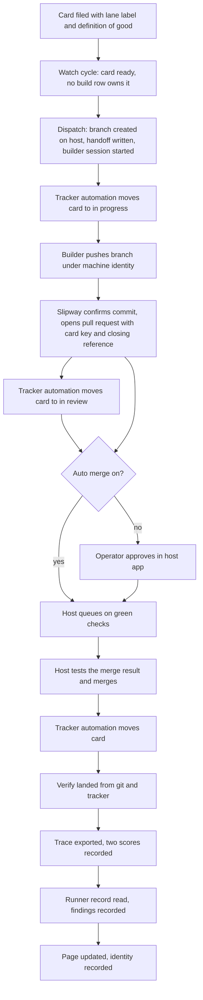
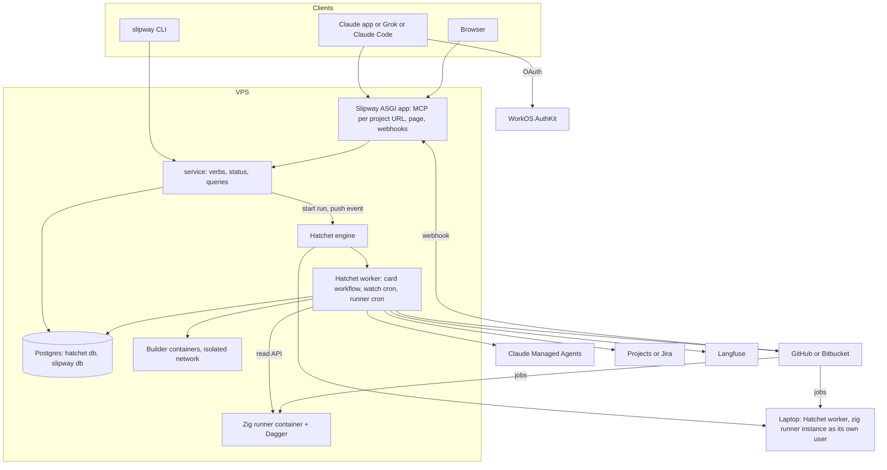
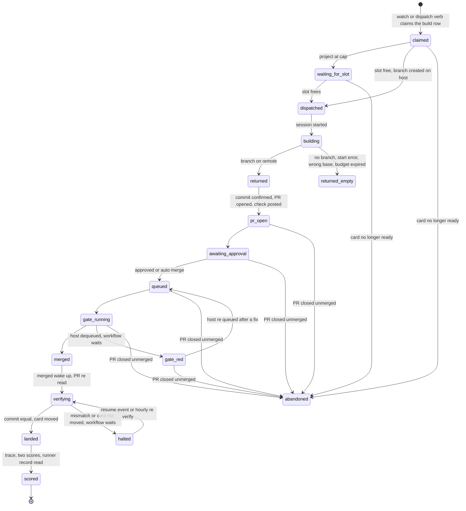
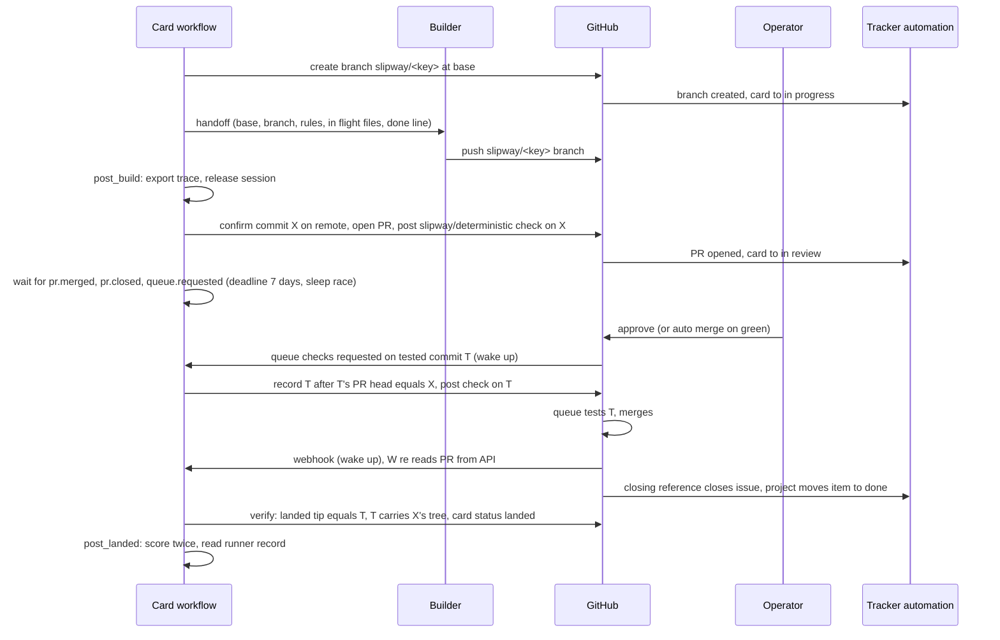
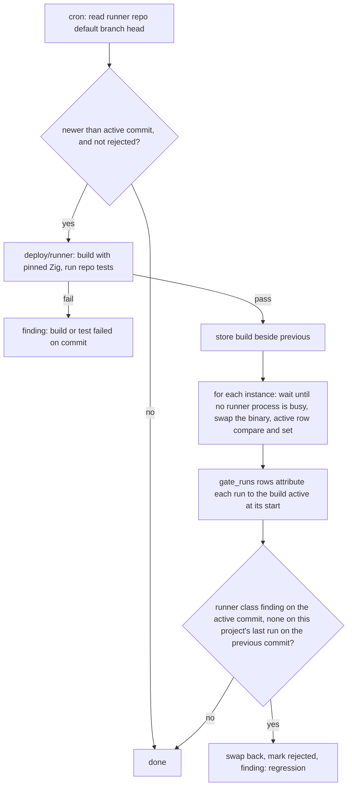
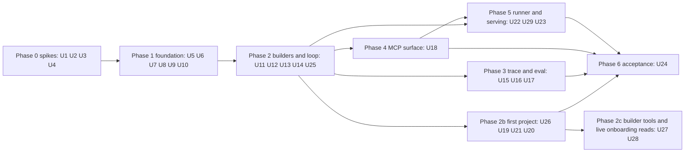

# Slipway First Version - Plan

## Goal Capsule

- **Objective:** A one person product engineering consultancy can file a card on any customer's tracker from a phone, have it built off the laptop by whichever builder the project allows, landed through one trusted merge path, scored against a written definition of good, and shown on one page, with nothing project specific inside the tool.
- **Means:** A Python service whose control loop is a durable workflow on a self hosted Hatchet engine (KTD2), driving builder adapters through one handoff (KTD6, KTD26), landing through each host's pull request path (KTD7), with every verb behind a per project MCP URL (KTD13).
- **Product authority:** Phillip Gutowski, sole operator. Manager agents, voice bots, further builder adapters, and multi operator tenancy are later areas and not active scope.
- **Execution profile:** Slipway is built from its own GitHub Projects board. Every unit below is one card. Cloud lane cards are built by a Claude Code cloud session that pushes a branch and opens a pull request, which auto merges on a green gate except on the paths KTD25 names. Operator lane cards (the four spikes, deploys, and the acceptance pass) need Phillip's accounts, phone, or host and are run by hand. The card template and lane rules are under Build Process in the Planning Contract.
- **Stop conditions:** A spike that disproves the fact it exists to prove stops the phase that depends on it and comes back to Phillip with the fallback the plan names. Evidence that a settled decision cannot work stops the work and comes back to Phillip; it is never resolved silently.
- **Open blockers:** None before building. Four spikes (U1 to U4) gate everything after Phase 0. One permission question (Outstanding Questions, resolve before acceptance) gates U24's Bitbucket onboarding only.
- **First customer:** Integra Workbench, a Bitbucket Cloud repository with its cards on Jira. Slipway stays project agnostic; the order below serves that project first. See "Reorder of 2026-10-21".

### Reorder of 2026-10-21

Phillip approved this order on 2026-10-21, after the build had reached the end of Phase 2 apart from the loop itself. Three things move to the front: the loop that runs a card, the Bitbucket and Jira path as the first class one, and onboarding that can be finished in one sitting. Builders that drive a browser or a desktop are new scope (U27); the plan had none. Nothing already merged changes. The order:

1. **The loop.** U4 (proved locally on 2026-10-21, `docs/spikes/hatchet.md`), then U14, then U25.
2. **The first project.** U26, the Integra lane (new); U19 terminal first, with its MCP front end moved to U18; U21 in a first slice; U20.
3. **Builder tools and live onboarding reads.** U27, a headless browser for every project, and the operator's real browser and desktop as a per project opt in (new). Then U28, the onboarding reads U19 left as attestations, and U29, serving the app and the worker on the VPS (both new, added the same day).
4. **Later.** U16 soon after step 2, since it needs no outside service. Then U1 and U12 (Managed Agents mounts GitHub repositories only, and the first project builds on the laptop), U3 and U18 (the MCP surface and voice), U15 and U17 (they wait on the Integrel export question), U22 and U23 (the Zig runner), and U24 last, with Integra Workbench as its first cold onboarding.

The Unit Index carries the new dependencies. The ready rule reads each card's own Dependencies line, so the board issues were edited to match on the same day (U18, U19, U21, U24) and U26 and U27 were filed as #83 and #84.

Two notes from the build of step 2, the same day. U26 checks an outside lander with the plain merge rule rather than the auto merge rule its card named, because the first project's watcher keeps landing other cards on the base branch. The plain merge rule finds the landing commit (the first commit on the base branch's first parent line that holds the confirmed commit) and compares its tree with the tree of merging the confirmed commit into that commit's first parent, so later landings on top of it do not matter. And U19 was built with five live reads still taken as operator attestations, since the adapters could not yet list or read them: board movement, the required check, the machine identity restriction, the repository, and the board. U28 (new, filed as #94) adds those reads, ahead of U24, so Integra's onboarding checks them instead of asking.

A third note, after U20 landed. No unit owned serving Slipway on the VPS: the process that answers on port 443, its certificate, the page's cookie signing key and base URL, and the `app` and `worker` compose services `deploy/README.md` describes. U29 (new, filed as #97) owns them, and writes the first `src/slipway/app.py` with the status page and the webhook endpoint; U18 later adds the MCP routes to that file, so U18 now depends on U29.

---

## Product Contract

Product Contract preservation: changed. R17 now says the builder pushes its branch under a machine identity the host restricts to Slipway's branch namespace and Slipway opens the pull request, resolving a contradiction with F1 (the brainstorm said both) and reflecting that neither host scopes a credential to a branch prefix. R26 adds Client ID Metadata Documents beside dynamic client registration, because the MCP specification deprecated the latter on 2026-07-28. R2 and R3 gain the fields the flows read but the brainstorm did not list. R36 to R41 are new, added at Phillip's direction on 2026-10-14 for the Zig actions runner and the build process; R42 is new, added at his direction the same day for live board status. R20 keeps the brainstorm's meaning (the commit on main is the one the gate tested) and adds that the tested commit carries the tree Slipway confirmed, because a merge queue tests a commit the host creates and squash or rebase merges never land the builder's own commit. R37 narrows rollback to a runner's own failure so a project's red test never rolls a good runner commit back. R22 widens from a fallback to the rule for every builder, chosen by Phillip on 2026-10-15 over paying for a longer Langfuse window, because the free tier keeps data thirty days and a trace in git lives as long as the project. F1 and its diagram now show approval before the queue, which is the order both hosts actually use. Every other R, A, F, and AE keeps its ID and meaning.

### Summary

Slipway is the landing and grading authority between any coding agent builder and a customer's repository. It takes labelled cards, hands each to a builder through one fixed handoff, opens one pull request per returned branch into the host's native merge path, verifies from git and the tracker that the card landed, stores the trace in Langfuse, scores the result two ways, records who did each step, and exposes every verb to agents over a remote MCP server with per project scoped access. The first version drives Claude Managed Agents and a headless CLI builder in a sandbox or on the laptop, speaks GitHub with Projects and Bitbucket Cloud with Jira, runs project gates on the operator's own instances of the Zig actions runner where a project opts in, and onboards a project through a guided one question at a time intake.

### Problem Frame

Phillip runs several projects, his own boards and Integrel's support-workbench, through two home grown build systems. The Relay runner holds about twenty thousand lines and two thousand tests and has never scored a result. The board lanes script lands branches well but knows one board, one macOS machine, and one terminal. Both put the laptop in the critical path: laptop closed, nothing dispatches, lands, or grades.

He is building a product engineering consultancy. Each customer brings a repository on a different host with a different tracker, and the customer's work has to flow through one path he trusts, off his machine, with a record he can show. Vendors now sell the building (Claude Managed Agents, Cursor Cloud Agents, Devin, Grok Build) and will add grading inside their own loops. None of them owns the repo side across builders: verifying a card actually landed, scoring any builder on the customer's rubric, holding the project's gate truth, and showing one page across every builder and project. That layer is the asset, and it does not exist yet.

He is also a collaborator on `Lementknight/zig-actions-runner`, a single binary replacement for GitHub's self hosted Actions runner that is going open source and iterating quickly. Using it as the gate runner for his own projects is how it gets tested, and the defects that surface need to become issues on its board without a hand on them.

### Key Decisions

- **Slipway does not build; builders are adapters behind one handoff, and the headless CLI builder is Slipway's own.** (session-settled: user-directed, chosen over every builder as an adapter: the CLI lane is what consumes subscription accounts and serves machine bound tasks.) Governs R9, R10, R11, R12.
- **Outcome parity with the runner and the lanes script, not feature parity.** (session-settled: user-approved, chosen over carrying every verb and process: the note's exclusions stand and the harness stays thin.) Governs R1, R2.
- **The whole first version is one contract.** (session-settled: user-directed, chosen over a replay eval only slice, a dispatch only slice, or an onboarding only slice: one dialogue, a multi unit plan built from a card queue.)
- **The control plane is hosted and unattended; the laptop is one optional builder.** (session-settled: user-approved, chosen over laptop first with host as config: the laptop was the bottleneck to remove.) Governs R4, R5, R6.
- **Landing is pull request first through the host's native merge path; Slipway never merges.** (session-settled: user-directed, chosen over a standing go per project and over every push waiting: pushing is automatic, a person approves the pull request, auto merge is a per project option.) Governs R17, R18, R19, R20.
- **The control loop is a workflow definition on a durable engine, not a runner with a state file.** (session-settled: user-approved, chosen over a hand written loop: hours long waits with approval steps and resume are what engines do, and the state file loop is where the old runner's size came from.) Governs R4, R7.
- **Traces live in Langfuse over OpenTelemetry; Slipway builds no trace folder or dashboard.** (session-settled: user-approved, chosen over a per task trace folder: open source, self hostable, runs rubric judges, free at one person scale.) Governs R21, R23.
- **Every build's mapped event log is committed to the card's side reference in git, and Langfuse is the viewer.** (session-settled: user-directed, chosen over paying for Langfuse Core: the free tier keeps data thirty days, and a trace in the project's own repository costs nothing and lives as long as the project.) Governs R22.
- **Claude Managed Agents is the first hosted builder; Cursor Cloud Agents and Grok Build are the next adapters, Devin is not yet.** (session-settled: user-directed, chosen over all three hosted vendors in the first version and over Devin now: Managed Agents has a session API and a full event log, Devin is not in use yet.) Governs R9, R11.
- **The surface is any MCP client; Grok, the Claude app, and a Claude Code session are the known three.** (session-settled: user-directed, chosen over the Claude app alone: one grokbot per customer is a surface Phillip wants available, and nothing in the xAI suite invalidates Slipway.) Governs R25, R26, R27.
- **Manager agents are configured, not built, in the first version.** (session-settled: user-approved, chosen over shipping a conversational orchestrator with or without voice: the orchestrator is a client of the verbs, and no product sells it yet.) Governs R25, R28.
- **One operator, with identity recorded on every step and per project scoped tokens.** (session-settled: user-directed, chosen over multi operator tenancy from day one: tenancy later becomes a permission model over records that already exist.) Governs R8, R27.
- **Accounts may be consumer subscriptions as well as API keys, and may be pooled across projects.** (session-settled: user-directed, chosen over API accounts only: Phillip checked the terms and allows it.) Governs R13, R14, R15.
- **The eval runs after landing and is informational.** Carried from the ideation note. Governs R24.
- **Slipway never writes the tracker.** Carried from the ideation note. The manager agent files cards and the tracker's own automation moves them. Governs R3, R20, R40.
- **Project agnostic is the first law.** Carried from the ideation note. Nothing project specific is code in the tool. Governs R1, R29, R30.
- **Gates may run on the operator's own instances of the Zig actions runner, opted into per project, and those instances track the runner's main branch.** (session-settled: user-directed, chosen over GitHub hosted runners only and over a pinned runner release: the runner is Phillip's own project, it iterates quickly, and running real gates on it is how it is tested.) Governs R36, R37, R38.
- **Runner defects are findings Slipway records; filing them as issues is an agent's act.** (session-settled: user-approved, chosen over Slipway filing issues directly: the never writes the tracker rule holds for every tracker, including the runner's own board.) Governs R39, R40.
- **The board shows every card's live stage, moved by the tracker's own automation on host events Slipway causes.** (session-settled: user-directed, chosen over the page as the only live view: with twenty agents on a project the operator reads the board, and the never writes the tracker rule holds because the automation writes, not Slipway.) Governs R42.
- **Every card ships as a pull request, and auto merge is a setting per repository.** (session-settled: user-directed, chosen over local merges for solo work: his own repositories follow the same landing path Slipway enforces for customers.) Governs R17, R19, R41. Conflict call-out: the security pass found that an auto merged change to Slipway's gate, deploy files, or credential paths lands on the host holding every customer credential with nobody reading the diff; KTD25 keeps auto merge on for Slipway's own repository and requires one review on those paths only. The per repository setting stands.

### Actors

- A1. **Operator.** Phillip. Onboards projects, holds accounts, approves pull requests, reads the page, writes definitions of good, runs operator lane cards.
- A2. **Manager agent.** A Grok bot, a Claude app project, or a Claude Code session, one per customer project. Talks to the operator, files cards, drives Slipway's verbs, reads status, files runner findings as issues. Outside Slipway.
- A3. **Builder.** A Claude Managed Agents session or a headless CLI session in a sandbox or on the laptop. Receives a handoff, pushes a branch.
- A4. **Host and tracker.** GitHub with Projects, or Bitbucket Cloud with Jira. Runs the merge path and the gate, moves the card on merge.
- A5. **Slipway.** The hosted workflow that dispatches, verifies, traces, scores, records, observes gate runners, and serves the page and the verbs.

### Requirements

**Project agnosticism and onboarding**

- R1. Slipway carries no knowledge of any one project; every project specific value is configuration the project supplies outside any repository.
- R2. One configuration file per project names the repository, host, tracker, board, lane label, ready status, in progress and in review statuses, landed status, gate command, allowed builders, accounts per role, model and effort per role, time budget per role, auto merge setting, a pinned landing path when the operator wants one, per project build cap, per day dispatch cap, the trivial card's target file, the trace store project, the tracker credential and host credential by their operator file names, the subjects allowed to hold a token, and where the project keeps its evals.
- R3. One configuration file per operator names the operator's own subject, the accounts the operator holds, each as a subscription login or an API key, the identity provider, the trace store projects, the gate runner instances and the runner repository they track, the builder workers and their labels, the tracker credentials, host credentials, runner registration tokens, and webhook secrets by name with the environment variables that hold them, and never appears in a project file.
- R29. The onboard verb runs a guided intake that asks one question at a time, offers choices wherever a choice exists, and ends with a working project file.
- R30. Onboard checks the four properties, independent tasks, durable state between tasks, an external gate that refuses broken changes, and a written definition of verification, and for each failing property it states what is missing and offers the fix as the next single step.
- R31. Onboard finishes by landing one trivial card end to end, so the first real card is not the first test; the card itself is filed by the caller, never by Slipway.
- R32. Onboard re entered on an existing project asks only the questions whose answers are missing or no longer true.
- R33. Onboard runs identically as a terminal wizard and through the MCP server, so a manager agent can onboard a customer from a phone conversation.

**Control plane**

- R4. Slipway runs on a host the operator does not have to keep awake, as a durable workflow whose every step resumes after a failure.
- R5. Slipway keeps many builds in flight per project up to the project's cap, with landing serialised per repository by the host's merge path.
- R6. Nothing in the control plane depends on the laptop except builds a project declares machine bound.
- R7. Slipway halts a card, never continues past it, when it cannot confirm an outcome from git or the tracker, and the page shows the halt with its evidence.
- R8. Every dispatch, approval, landing, score, finding, and runner update records which operator or agent caused it.

**Dispatch and builders**

- R9. A card carries its lane from the moment it is filed, by a label chosen from a few plain words, and Slipway dispatches only cards that carry one.
- R10. Every builder receives the same handoff: base commit, branch name, the project's rules, the files other in flight builds are editing, and the done line, and returns a branch at a commit.
- R11. The builder adapter contract is written against six primitives, harness, environment, tools, skills, credentials, and schedule, so a Managed Agents session, a Cursor Cloud Agent, a Grok Build run, or a headless CLI session fits without changing the contract.
- R12. Every build runs in a fresh environment; nothing carries between cards except what landed in git and on the tracker.
- R13. A project binds each role, builder, judge, and any helper, to one account from the operator file and one model and effort.
- R14. A subscription account is consumed by a headless CLI session logged in as that account in a sandbox Slipway controls or on the laptop; an API key account is consumed by the provider's session API.
- R15. Every task records the account, model, and cost or token usage it consumed, visible per project and per customer.
- R16. A remote builder reads nothing on the operator's machine; the handoff carries every rule it needs, including which tests are machine bound.

**Landing**

- R17. The builder pushes its returned branch under a machine identity the host restricts to Slipway's branch namespace, and Slipway opens one pull request per card, titled with the card's key, into the host's native merge path.
- R18. The gate is the project's own CI run by the host on the merge result, plus Slipway's deterministic checks posted as a check on the pull request, and Slipway never runs a merge itself.
- R19. A pull request merges when a person approves it in the host, or automatically when the project has auto merge on, and Slipway records which.
- R20. Verify landed reads git and the tracker only: the commit on main is the commit the gate tested, that tested commit carries exactly the tree of the branch head Slipway confirmed when it opened the pull request, and the card moved by the tracker's own automation. A builder's claim is never evidence.

**Trace and eval**

- R21. Every task exports the builder's full event log, every tool call, file change, command, and outside connection, to Langfuse as one trace.
- R22. Every build's event log, mapped to the trace shape, is committed to a side reference on the project's repository so the trace lives as long as the project; when a provider cannot return its event log after a session ends, the builder's own action log on that reference is what the trace is built from.
- R23. Every task's trace holds the diff or branch so it can be graded later by replay.
- R24. Every landed task gets two scores kept apart: a deterministic score (gate passed, diff inside declared paths, the test the card named exists and runs) and a judged score (a fresh model, given the card's definition of good and the diff, returns a rubric result), recorded against the task's trace.

**Surface and verbs**

- R25. Every verb, onboard, dispatch, status, land, eval, trace, and watch, is callable by an agent through a remote MCP server as well as by a person in a terminal.
- R26. The MCP server authenticates with OAuth 2.1 using PKCE, accepting both Client ID Metadata Documents and dynamic client registration, so Grok, the Claude app, and Claude Code can connect.
- R27. An MCP token is scoped to one project; a manager agent for one customer can read nothing of another customer's cards, status, in flight facts, traces, or findings.
- R28. The page shows, per project and across projects, what is being built, what is waiting to land, what needs the operator, and the link into the host where each approval is made; it holds no approval state of its own.

**Trackers and hosts**

- R34. Tracker adapters are read only, derived from the runner for GitHub and Jira, with Bitbucket Cloud added as the host for Jira projects.
- R35. The three cold onboardings pass with no code change: a GitHub repository with a GitHub Projects board, a Bitbucket Cloud repository with a Jira board, and a project Slipway has never seen.

**Gate runners and findings**

- R36. Slipway deploys instances of the Zig actions runner on its own host and on the laptop, each registered at repository scope with labels, and a project opts in by naming those labels in its own workflow; nothing in Slipway assumes a project uses them.
- R37. Runner instances track the runner repository's default branch: a new commit is built with the Zig version the repository pins, tested with the repository's own tests, and rolled onto each instance when it is idle, with the previous build kept and restored automatically when a gate on the new build fails for a reason of the runner's own (R39) that gates on the previous build did not produce; a project's own red test is never a reason to roll back.
- R38. Every gate run and every finding records the runner commit it ran on.
- R39. After every gate run on a runner instance, Slipway reads the runner's own record of the job and records a finding when it sees an unsupported step, a runner offline with a job queued, a conclusion that disagrees with the host's, a log sequence gap, a database write failure, or a rollback, each with a fingerprint that makes the same defect one finding.
- R40. Findings are readable by verb and page; filing one as an issue on the runner's repository is done by an agent process with fixed instructions that checks the fingerprint against open and recently closed issues first, never by Slipway itself.
- R41. Slipway's own repository is a Slipway project: its cards live on a GitHub Projects board, its gate runs on a runner instance, and every card lands as a pull request.

**Board status**

- R42. A card's column on its board shows its current stage in real time: in progress from the moment its branch exists on the host, in review from the moment its pull request opens, done when it merges, each moved by the tracker's own automation keyed on those host events, never by Slipway; a halt or needs you state shows on the pull request itself as a failing check with its reason. Onboard treats a board that cannot move on those events as a failing property and offers the automation as the next step.

### Key Flows



- F1. One card, end to end
  - **Trigger:** A manager agent files a card with the lane label and a definition of good.
  - **Actors:** A2, A5, A3, A4, A1
  - **Steps:** The watch cycle sees a ready card no build row owns and claims it. Slipway creates the card's branch on the host at the base commit, which moves the card to in progress through the tracker's own rule, writes the handoff, and starts a builder in a fresh environment bound to the project's account. The builder pushes its branch. Slipway confirms the commit on the remote, opens a pull request titled with the card key, carrying the closing reference the tracker adapter renders, and posts its deterministic check; the tracker's rule moves the card to in review. The operator approves in the host app, or auto merge takes the pull request on green. The host tests the merge result on its queue where one exists and merges. Tracker automation moves the card to done. Slipway verifies from git and the tracker, exports the trace, scores it twice, reads the runner's record of the gate, records who did each step, and updates the page.
  - **Outcome:** The card is done, the commit on main is the one the gate tested and carries the tree Slipway confirmed, and the scores and trace are readable.
  - **Covered by:** R9, R10, R12, R17, R18, R19, R20, R21, R24, R28, R39, R42

- F2. Onboarding a customer project
  - **Trigger:** The operator or a manager agent runs onboard for a repository Slipway has never seen.
  - **Actors:** A1 or A2, A5
  - **Steps:** One question at a time with choices: host, repository, tracker, board, lane label, ready and landed statuses, gate command, builders, accounts per role, auto merge, caps, the trivial card's target file, trace store project, allowed subjects, evals location, and whether any other system dispatches this board. Every answer is validated, then saved. The four properties check runs and each failing property returns one next step with its fix. Onboard returns the trivial card for the caller to file, waits for it, and marks the project verified when it scores.
  - **Outcome:** A project file exists outside any repository and the first real card can be filed.
  - **Covered by:** R2, R29, R30, R31, R32, R33, R35

- F3. Halt on an unconfirmable outcome
  - **Trigger:** A pull request merged but the card did not move, or the merged commit differs from the confirmed one.
  - **Actors:** A5, A1
  - **Steps:** The workflow stops that card at a wait, records the evidence, posts a failing landing check on the pull request with the reason, and shows it under needs you with the link into the host. The operator repairs by hand; the hourly re verify inside the wait, or the land verb's resume event, re runs verify. A commit mismatch with no repair is accepted only through the land verb's override from the operator, which records who, why, and both commits.
  - **Outcome:** No card is counted landed without both git and the tracker agreeing, and no halt is stuck without a named exit.
  - **Covered by:** R7, R8, R20, R28

- F4. Swapping a model or an account
  - **Trigger:** The operator edits a project's role binding to a different model, effort, or account.
  - **Actors:** A1, A5
  - **Steps:** Each workflow step reads the binding when it runs and records what it used. Cards already in a builder session keep that session. Scores and cost for tasks before and after are visible side by side per project.
  - **Outcome:** The swap is a config edit whose effect is readable in the scores.
  - **Covered by:** R13, R15, R24

- F5. A runner defect becomes an issue
  - **Trigger:** A gate run on a runner instance ends and Slipway's read of the runner's record shows one of the conditions in R39.
  - **Actors:** A5, A2
  - **Steps:** Slipway records a finding with its fingerprint, runner commit, job, step, and a bounded log excerpt. The finding appears on the page and in the findings verb. The runner project's manager agent, or the operator from the terminal, runs the filing step: an agent process with fixed instructions and two templated tools searches the runner repository's open and recently closed issues for the fingerprint, files the issue from Slipway's rendered template if none exists, and records the issue link on the finding.
  - **Outcome:** One defect, one issue, with the exact runner commit named.
  - **Covered by:** R38, R39, R40

- F6. The runner tracks its main branch
  - **Trigger:** The scheduled reconcile sees a commit on the runner repository's default branch newer than the one an instance runs and not previously rejected.
  - **Actors:** A5, A4
  - **Steps:** Slipway builds the commit in a sandbox with the pinned Zig version, runs the repository's tests, keeps the build beside the previous one, and swaps each instance when none of its runner processes is busy. Gate runs after the swap are attributed to the new commit by their start time. A gate run on the new commit that produces a runner class finding (an unsupported step, a log gap, a database write failure, a conclusion disagreement) where this project's last gate on the previous commit on that instance produced none rolls the instance back, marks the commit rejected, and records a finding; a plain red test is a project red and changes nothing.
  - **Outcome:** Instances are never more than one reconcile behind main, a bad commit costs one gate run, a project's own failure never rolls the runner back, and a rejected commit is not redeployed.
  - **Covered by:** R37, R38, R39

### Acceptance Examples

- AE1. **Covers R19, R20.** Given a project with auto merge off and a green gate, when the operator approves the pull request in the Bitbucket app, then the queue merges, Jira moves the card, and Slipway records the landing as approved by the operator with the merged commit equal to the commit the queue tested and that commit carrying the confirmed tree.
- AE2. **Covers R7, R20.** Given a pull request that merged while the card stayed in progress, when verify runs, then the card is halted with the evidence shown under needs you, and the page does not count it as landed.
- AE3. **Covers R12, R14.** Given a project bound to a subscription account for the builder role, when two cards are dispatched, then two separate CLI sessions run in two fresh environments logged in as that account, and neither sees the other's files or configuration directory.
- AE4. **Covers R27.** Given two customer projects and a Grok bot holding a token for the first, when the bot asks for status, then it receives only the first project's cards, in flight facts, and scores, and a lookup of the second project's card key returns not found with no mention of that project.
- AE5. **Covers R22.** Given a builder whose provider returns no event log after the session ends, when the task lands, then the trace is built from the action log the builder pushed on its side reference, and the judged score still runs.
- AE6. **Covers R30.** Given a repository with no CI gate, when onboard runs, then it stops at the gate property, says that an external gate that refuses broken changes is missing, and offers adding one as the next single step before any card can be filed.
- AE7. **Covers R24.** Given a landed card whose definition of good names a test, when the deterministic score runs, then it fails if that test does not exist or did not run in the gate, independent of the judged score.
- AE8. **Covers R33.** Given a manager agent connected over MCP, when it calls onboard, then it receives the same one question at a time sequence with the same choices a terminal user sees, and both end by returning the same trivial card to file.
- AE9. **Covers R5, R9.** Given one labelled card and a project with free slots, when dispatch is called three times within a minute, then one build runs, one pull request opens, and the second and third calls return the first build's state.
- AE10. **Covers R39, R40.** Given a gate run whose step failed with the runner's unsupported message, when the filing step runs twice, then exactly one issue exists on the runner repository, it names the runner commit, and the finding records the issue link.
- AE11. **Covers R37.** Given a runner instance on commit A and a new commit B on main, when the reconcile runs and B's build and tests pass, then the idle instance runs B; a gate that then fails with an unsupported step finding for a project whose last gate on A had no runner finding puts the instance back on A, marks B rejected, and records a finding; a gate that fails only because the project's own test is red leaves the instance on B.
- AE12. **Covers R17, R20.** Given a pull request Slipway opened at commit X with auto merge on, when the branch is pushed again to commit Y before merging, then Slipway posts a failing deterministic check on Y, the pull request does not auto merge, and verify would refuse a merge of Y as a commit mismatch.
- AE13. **Covers R42.** Given a project whose board automation is in place, when a card is dispatched, then its board column reads in progress once the branch exists, in review once the pull request opens, and done once it merges, and Slipway wrote nothing to the tracker; given a board without that automation, when onboard runs, then it stops at the durable state property and offers the automation as the next step.

### Success Criteria

- The three cold onboardings pass with no code change (R35), and one scored card lands on each.
- A full day passes with the laptop closed and cards still dispatched, landed, and scored.
- The first eval is tuned by replaying tasks already landed in an existing repository before any new build is scored.
- Every unit of harness in the repository names the grade, trace, or task it exists for.
- Every card of Slipway's own first version that lands after U22 does so through a pull request whose gate ran on a runner instance.

### How This Work Fits Together

<!-- ce-section: work-relationships -->

This plan covers the first version of Slipway: the hosted loop, two builders, two host and tracker pairs, the MCP surface, guided onboarding, and the runner as gate and as project. The breakdown below is the current understanding, not a committed roadmap.

- Manager agent layer: a per customer Grok bot or Claude app project configured against the MCP server. Depends on this plan's R25, R26, R27. Can proceed independently of everything else once the server exists.
- Built voice bot on xAI's Voice Agent API or LiveKit: Still to decide, pending the voice spike. Depends on the manager agent layer.
- Further builder adapters, Cursor Cloud Agents then Grok Build then Devin: Depends on R11 and KTD26. Each can proceed independently.
- Multi operator tenancy: Depends on R8 and R27. Shares the per project token model.
- Budget based routing across accounts: Depends on R13 and R15. Still to decide.
- `Lementknight/zig-actions-runner` as a Slipway project: depends on U24. Its own roadmap (private repositories, more `uses:` actions, `container:` jobs) widens what the runner can gate and is tracked on its board, not here.

### Scope Boundaries

**Deferred for later**

- Cursor Cloud Agents, Grok Build, Devin, Gemini, and OpenHands adapters.
- A built conversational orchestrator or voice bot.
- Multi operator tenancy beyond per project scoped tokens.
- Automatic routing of a task to whichever account has budget left.
- Grouping several cards into one pull request.
- A Daytona or other sandbox twin for every machine bound project.
- Push delivery of a build's completion to a manager agent; the first version is a cursor read (KTD14).
- An outbound notification to the operator when a card reaches needs you; the page is pull only in this version.
- Cancelling a running builder session when its card is relabelled or closed mid build; the first version stops at the next step boundary.
- Judged score reruns from a project scoped token; reruns are terminal only while the judge is tuned.
- Self hosting Langfuse; the Hobby cloud tier carries the first version.

**Outside this product's identity**

- Building. Slipway never writes code; it dispatches, verifies, traces, scores, and shows.
- Merging. The host's merge path merges; Slipway never runs a merge.
- Writing the tracker. Manager agents file cards and issues; tracker automation moves them.
- Session bring up, terminal tabs, clipboard handoffs, the feeder loop, mirror rules, disallow patterns, the markdown adapter, and the closeout process from the earlier systems.
- Holding its own approval state. Approvals live in the host's pull request.
- Executing a project's code on the control plane. Gates run on the host's CI; builds run in builder containers; Slipway's worker runs none of it (KTD18).

**Considered and not built**

- A per account concurrency limit across pooled projects. Two projects under their own caps can exceed one subscription's concurrency; the provider error surfaces as a halt with class `builder_failed`, which the operator sees the first time it happens. Build it when that halt recurs.
- An approval inbox inside Slipway, or a per project "dispatch requires the operator" flag. The host's pull request is the inbox. The per day dispatch cap bounds a looping agent's spend. Build the flag when a customer asks for a go before every spend.
- Validation of a hand edited project file at edit time. Dispatch validates the binding before any spend and halts with `binding_invalid`; the operator sees it within one watch cycle.
- A timestamp or nonce on host webhooks. Neither host offers one, so replay cannot be prevented at the signature; KTD10 makes events wake ups rather than evidence instead, which closes the same path.
- A project delete command and record pruning as first version features. The cascade foreign keys and the ledger (KTD16) cost nothing in the first migration and are kept; the delete command and the thirty day prune move to follow up, because a retired project is noticed by the operator and a delete can be added without a data format change.

### Deferred to Follow-Up Work

- Lift `candidates()` from the runner's adapters for a dashboard of all not done cards; the page reads Slipway's records only in this version.
- Move the Slipway and zig runner repositories under a GitHub organization if U2 shows merge queue is unavailable on personal account repositories and the auto merge fallback proves too weak, or if U23's filing credential needs an organization scoped app.
- An import graph lint in CI (KTD23) is written in U5 as a test; promoting it to a dedicated linter is follow up.
- `slipway project delete` and the thirty day `host_events` prune (Considered and not built).
- A confirming rerun of the same host job on the previous runner build as a second rollback signal (KTD20 uses runner class findings only in this version).

### Dependencies / Assumptions

- Claude Managed Agents persists the full event list after a session ends and serves it from `GET /v1/sessions/{id}/events`, with `agent.tool_use`, `agent.tool_result`, `span.model_request_end`, and `session.usage` events. Documented; U1 confirms it after archive. Managed Agents is not eligible for zero data retention; transcripts persist at Anthropic until deleted.
- Managed Agents mounts GitHub repositories only, through a git proxy that keeps the token outside the sandbox. A Bitbucket build in a Managed Agents session clones with plain git in bash; whether a vaulted credential reaches git's auth header is unverified and is U1's second fact. Fallback: the session writes a bundle to outputs and Slipway pushes.
- Neither GitHub nor Bitbucket Cloud scopes a write credential to a branch prefix. GitHub fine grained tokens cover only repositories the holder owns or belongs to, so a customer repository needs a GitHub App installation token; Bitbucket app passwords are on Atlassian's retirement schedule, so the credential is a repository access token. U2 confirms both still work and that rulesets and branch permissions can exclude the machine identity (KTD6).
- GitHub's merge queue is documented for Enterprise Cloud private repositories and organization owned public repositories; availability on personal account repositories is U2's first fact. Fallback: GitHub auto merge with "require branches to be up to date", recorded as a weaker landing (KTD7).
- Bitbucket Cloud merge queues have no API to enqueue; the "automatically queue once builds pass" setting is the only unattended path, and U2 proves it.
- Grok's and the Claude app's custom MCP connectors work in voice mode on a phone. Primary evidence for the Claude app; unverified for Grok. U3 proves it.
- Pooling consumer subscriptions across projects is permitted. Phillip checked and allows it. Anthropic's terms say limits assume ordinary individual usage; `ANTHROPIC_API_KEY` is the documented fallback and the CLI prefers it when set.
- Integrel permits Bitbucket and Jira credentials on a host Phillip controls and hosted builders reading support-workbench. Phillip confirmed. Whether that permission covers transcripts persisting at Anthropic and diffs at Langfuse cloud is open (Outstanding Questions).
- Langfuse's Hobby tier (50k units a month, 2 users) covers one operator's volume, and its data access window is thirty days (vendor page, 2026-10-14), so Postgres holds every fact the record needs past that window (KTD16), the side reference holds the trace itself (R22), and the Langfuse link is a viewer.
- Slipway's repository is public, a decision carried from the ideation note; the runner's v0 subset supports public repositories only, so Slipway's own gate can run on an instance. The Definition of Done rule against host names and home paths is therefore a public exposure rule, not hygiene.
- Both hosts' merge queues test a commit the host creates and land that commit; a merge made with auto merge under squash or rebase lands a commit with one parent. R20's relation is therefore "merged equals tested, and tested carries the confirmed tree" on queue paths and "merged carries the confirmed tree" on the auto merge path (KTD7). U2 records the merge method per repository.
- The runner's GitHub and Jira adapters and its verify landed are derived from `native-relay` as files with their constructors rewritten (KTD8). The runner's lease is not lifted (KTD4). The runner has no Bitbucket adapter and no eval code; both are new.
- Hatchet documents concurrency strategies per workflow and durable event waits, but no run deduplication key. U4 learns what a second run with the same key does; the plan does not rely on it (KTD3).
- The Zig actions runner's v0 subset is `run:` steps, `env`, `working-directory`, `shell`, `if:`, expressions, and `uses: actions/checkout`; private repositories are unsupported; one job per instance. Slipway's own CI is written inside that subset (KTD19).
- One small VPS hosts the Hatchet engine, Postgres, the Slipway service, builder containers, the Dagger engine, and runner instances. Sizing is U4's side fact.

### Outstanding Questions

**Resolve Before Planning**

- None.

**Resolve Before Acceptance**

- Does Integrel's permission cover support-workbench transcripts persisting at Anthropic (Managed Agents has no zero data retention) and its diffs stored at Langfuse cloud? If not, the Bitbucket project in U24 uses the CLI builder only and exports a trace summary without the diff, and U15 carries a per project `trace_detail` switch. Phillip asks Integrel; U24 waits on the answer for that one onboarding.

**Deferred to Implementation**

- The exact Hatchet maximum for a durable event wait is undocumented. U14 adds a deadline step (seven days, then needs you) so no wait is open ended.
- How a manager agent gets its own identity provider subject (a WorkOS user per bot) when Phillip is the only human who signs in; U3 records the mechanism it finds, and the allowed subjects list in the project file is the control either way.
- Whether WorkOS AuthKit honours the RFC 8707 `resource` parameter and emits it as the token audience, and whether its sign up can be closed to a list. U3's facts; the fallback is a minimal authorization server in Slipway.
- Whether any consumer MCP client receives server notifications or supports long running tool calls. U3 checks; watch's push half waits on it.
- Whether the host accepts the action log side reference under `refs/slipway/log/<key>`; U11 fixes the convention and U13 implements it, with an excluded path under the branch as the documented alternative.
- The exact Dagger and Zig toolchain layout on the VPS image. U22 decides from the runner's own README at build time.

### Sources / Research

- `docs/ideation/2026-10-14-software-factory.md`, the seed note: principles, carried rules, settled decisions, and acceptance targets.
- `docs/research/2026-10-14-brainstorm/grounding.md`, the grounding dossier with verified pointers into the runner (`native-relay`) and the lanes script (`agent-config/skills/board-lanes`).
- `docs/research/2026-10-14-brainstorm/`: nine brainstorm reports on traces and evals, builders, orchestration, landing, manager agents, and the xAI suite.
- `docs/research/2026-10-14-plan/repo-research.md`: what each lifted `native-relay` file imports, which methods survive, and which tests lift. Shapes KTD4, KTD8, U8, U10.
- `docs/research/2026-10-14-plan/framework-docs-engines.md`: Hatchet, Inngest, Temporal durable wait, concurrency, self hosting, and the Claude Code headless subscription rules. Shapes KTD2, KTD12, U4, U13.
- `docs/research/2026-10-14-plan/framework-docs-apis.md`: MCP authorization specification 2026-07-28, the `mcp` Python SDK auth module, Claude app and Grok connector facts, Managed Agents API shape, GitHub and Bitbucket merge queue APIs, Jira and Projects automation. Shapes KTD6, KTD7, KTD9, KTD13, U1, U2, U3.
- `docs/research/2026-10-14-plan/agent-native.md`: the verb classification, tool list, idempotency, project from token, onboard as one state machine. Shapes KTD14, KTD15, U18, U19.
- `docs/research/2026-10-14-plan/spec-flow.md`: the card state machine and the five contract gaps. Shapes KTD3, KTD5, KTD6, KTD10, KTD11.
- The deepening pass of 2026-10-14 (security, architecture, data integrity reviews, saved with the plan's review evidence): shapes KTD3, KTD4, KTD6, KTD10, KTD16, KTD18, KTD23 to KTD26, U25.
- The document review of 2026-10-14 (coherence, feasibility, scope, security, adversarial; the resolved review is saved beside the deepening reports): shapes R20, R37, KTD7, KTD11, KTD20, KTD22, KTD26 to KTD28, and the runner, verify, and workflow units.
- `Lementknight/zig-actions-runner` at commit `850cf9a`: `README.md`, `docs/SPEC.md` sections 4 to 6 (schema, read API, supported subset), `.github/workflows/ci.yml` (the `[self-hosted, zig]` job). Shapes KTD19, KTD20, U22, U23.

---

## Planning Contract

### Key Technical Decisions

- KTD1. **Python 3.12 with a `src` layout, `pyproject.toml`, `pytest`, and `ruff`, standard library first.** The lifted files are standard library Python; the three SDKs the plan needs (`hatchet-sdk`, `mcp`, `anthropic`) are Python first. No ORM; SQL migrations applied by a small command with a ledger (KTD16).
- KTD2. **The engine is Hatchet, self hosted with the `hatchet-lite` image and one Postgres on the VPS, driven by `hatchet-sdk` 1.42 or later.** Inherits the user-approved durable engine decision and cites R4, R5, R7. Chosen over Inngest, whose Python SDK is second tier by its vendor's own words and whose server is SSPL, and over Temporal, which has no per key concurrency and would have Slipway write the landing lock the plan exists to stop writing. Hatchet is MIT, Postgres only, and declares concurrency keys on tasks.
- KTD3. **Card ownership is a row in the `builds` table, never the engine.** The invariant: at most one build per (project, card key) whose state is outside the ownership terminal set `scored`, `abandoned`, `returned_empty`, enforced by a partial unique index. A `claim(project, key, actor, reason)` function inserts that row, or returns the existing one, in one transaction before any engine call; watch and the dispatch verb both call it, so the database decides the race and the loser returns the winner's state (AE9). The workflow's own first step writes its run id onto the build row with a compare and set on a null run id and exits as a no op when another run id is already there, so a crash between the engine accepting a run and the id being stored can never leave two live runs for one build. A claimed row with no run id older than one watch interval is retried by watch, not re claimed. `returned_empty` and `abandoned` reopen only through the dispatch verb with a reason and a new branch name. `gate_red` and `halted` keep a live workflow (KTD11). The engine's own key is belt, not braces; U4 learns what Hatchet does with a second run on the same key. Cites R5, R9.
- KTD4. **The runner's lease is not lifted. Two Hatchet concurrency keys replace it, each on a child task, never on the durable parent: the build child at `input.project` up to the cap, counting cards from dispatched to returned; the push confirm and open child at `input.repository` at one.** A concurrency key is a label the engine counts running work under. The parent that waits days for approval declares no key, so a slow approver never starves builds. The in flight files fact counts cards from dispatched to merged, a different set with its own name. U4 proves the layout and records whether a waiting parent counts against a key. Cites R5, R10.
- KTD5. **A card carries a fenced `slipway` block in its body with `good`, `paths`, and `test` keys, parsed by the tracker adapter's read.** Absent `paths` contributes nothing to in flight files until push and records "not declared" in the deterministic score. Absent `good` records "no rubric", not zero. Absent `test` records "none named". The same block is what `check_card` validates. Cites R9, R10, R24, AE7.
- KTD6. **The builder pushes its own branch under a repository wide machine identity, and the host enforces the branch namespace.** Neither host scopes a credential to a branch prefix, so the identity is a Slipway GitHub App installation token the customer installs (one hour expiry, minted per session) or a Bitbucket repository access token, and the customer repository carries a ruleset (GitHub) or branch permissions (Bitbucket) that restrict every reference except `refs/heads/slipway/**` and the log side reference for that identity, with the identity absent from any bypass list; onboard's gate property check includes that restriction. Managed Agents' GitHub mount keeps the token outside the sandbox and is the safer builder. The installation token lives one hour and builds may run longer, so the credential object is refreshable: the CLI container's credential helper reads a token file the adapter rewrites every fifty minutes, and the Managed Agents adapter rotates the mounted repository's token through the session resources update call on the same cadence inside its poll loop. Slipway creates the card's branch on the host at dispatch (KTD27), confirms the pushed commit on the remote, records it as the confirmed commit, opens the pull request, and holds the only credential that opens pull requests. A later push to the branch (AE12) is caught by a `pull_request` synchronize webhook that posts a failing deterministic check on the new head, and verify relates the merged commit to the confirmed one as KTD7 says. Inherits the user-directed landing decision; cites R16, R17, R20.
- KTD7. **Approval precedes the queue on both hosts, and Slipway's needs you entry says so; verify's relation between the confirmed commit and the landed commit depends on the landing path, never on commit equality alone.** On GitHub, Slipway enqueues with `enqueuePullRequest` once required reviews and checks pass, or lets auto merge do it; when the live landing path probe (KTD9) finds no merge queue on the repository, the project runs GitHub auto merge with "require branches to be up to date" and verify records the landing as `auto_merge_strict`. On Bitbucket, the repository's "automatically queue once builds pass" setting enqueues; if U2 shows it needs a click, needs you names the click. On a queue path the host tests a commit it creates (GitHub's `merge_group.head_sha`, Bitbucket's merge result commit); Slipway records it as the tested commit when the queue's checks requested event arrives, after checking the group's pull request head equals the confirmed commit, and posts its deterministic check on that tested commit too, since a required check must exist on the queue's commit or the queue never merges. Verify then checks that the landed tip equals the tested commit and the tested commit's recorded pull request head equals the confirmed commit. On the auto merge path the landed commit is a merge, squash, or rebase of the confirmed head onto an up to date base, so verify checks that the landed tip's tree equals the confirmed commit's tree, which holds for all three merge methods. Land detection is the host's merged webhook as a wake up (KTD10). Cites R18, R19, R20, AE1, AE12.
- KTD8. **Tracker adapters and verify are derived files from `native-relay`, not copies.** Each keeps the origin path in its docstring. The GitHub adapter keeps its `gh` CLI transport behind the injectable `run` callable, so the service image carries `gh` authenticated with a token; the Jira adapter keeps `urllib` with Basic auth from named environment variables. Both drop the eight closeout, filing, and triple coordinator methods and the comment search `closing_reference` read (Slipway never writes the comment it searched for), gain `labels` on `read`, and gain `closing_reference(key)` that renders the title token, body line, and branch token the tracker's own automation keys on. Verify keeps `Verdict`, `hand_landing`, `new_commit_since_baseline`, `card_terminal`, and the landed or partial landing rule, with a signature of repository, baseline commit, confirmed commit, tested commit, merged commit, card key, tracker status, and landing path; `hand_landing` becomes evidence rather than a gating check, because a GitHub merge commit message names the pull request number and not the card key, so landed requires only the commit relation (KTD7) and the card's terminal status. The trimmed `gitread` lifts `run`, `GitError`, `rev_parse`, `fetch`, `log_oneline`, `log_messages`, and `default_branch`; `tree_of` is new Slipway code. Tracker credentials are named in the project file by their operator file names and resolved through the operator file (R3), never by an environment variable name in the project file. Cites R20, R34.
- KTD9. **Host adapters are new code with one interface: create branch at a commit, confirm commit on remote, open pull request (taking the tracker's closing reference object), read pull request state, enqueue where an API exists, post a check on any commit, probe the landing path and merge method, verify and parse a webhook.** GitHub uses REST and GraphQL under the operator's app or token; Bitbucket Cloud uses REST with a repository access token. The landing path and merge method are a live probe of the repository's ruleset or queue setting, which the project file may pin; U2's findings are its fixtures and never a table in code. Cites R1, R17, R18, R34, R42.
- KTD10. **A host event is a wake up, never evidence.** Slipway's own webhook endpoint refuses any payload whose repository is not one Slipway manages before it chooses a secret, verifies the host's HMAC with a constant time compare, caps the body, drops any payload whose pull request Slipway did not open, writes the normalised event to `host_events` deduplicated on the host's delivery id, and pushes it into Hatchet; a durable sleep races every wait as the fallback poll, and the poll path writes the same `host_events` row with source `poll` through one ingest function. Every event driven transition re reads the pull request from the host API before `record_transition`. Webhook secrets are one per repository in the operator file, with two accepted during a rotation window. Cites R4, R7.
- KTD11. **Halt classes are a closed set in one module: `merged_card_not_moved`, `commit_mismatch`, `tracker_unreadable`, `git_unreadable`, `builder_failed`, `builder_expired`, `binding_invalid`.** A new outcome is a finding attached to a record, not a new class. The classes split by where they occur. `merged_card_not_moved`, `commit_mismatch`, `tracker_unreadable`, and `git_unreadable` are verify halts: the workflow enters the `halted` wait on a `card.resume` event raced with an hourly re verify, posts a failing landing check on the pull request with the reason (R42), and every transition stays inside the workflow. `builder_failed`, `builder_expired`, and `binding_invalid` are build outcomes: the build ends as `returned_empty` with that class as its reason, which is an ownership terminal state the dispatch verb can reopen, so no card is ever stuck in a wait that only a merge could end. Before verify records `merged_card_not_moved` it re reads the tracker every thirty seconds for ten minutes, because the host's merged event arrives before the tracker's own rule has moved the card. The land verb pushes `card.resume`; its override argument accepts a `commit_mismatch` with who, why, and both commits recorded, and only the operator's subject may pass it. `gate_red` is likewise a wait for the host's next event. Cites R7, R8, F3.
- KTD12. **The headless CLI builder runs in Docker on the VPS, one container per card with an empty configuration directory, the subscription token by environment only, the transcript copied out from that configuration directory before the container is removed; the laptop is a Hatchet worker that connects out to the engine, so a laptop build is pushed to it with no polling, under the worker label the operator file gives that builder.** Container baseline: non root, no Docker socket, read only root filesystem except the workspace, its own Docker network with egress limited to the code host and package registries and no route to the compose network or host private addresses, git credential through a credential helper and never in the remote URL. The laptop worker runs as a dedicated user with its own home, holds only its Hatchet worker token, the subscription token, and the git credential, and launches each session as a second user with an empty configuration directory; it runs only the `laptop_build` child, which returns the builder result to the parent on the VPS, so the laptop never holds the Postgres connection or the operator file. Daytona is the documented upgrade when host contention bites. `ANTHROPIC_API_KEY` per card bounds the blast radius and is the fallback if subscription use is enforced against. Inherits the user-directed CLI builder decision; cites R6, R14, R16, AE3.
- KTD13. **The MCP server is a Streamable HTTP resource server on the official `mcp` 2.x SDK with one URL per project and `validate_token_resource` on; an external authorization server (WorkOS AuthKit) authenticates, and Slipway authorizes.** The authorization server supports PKCE, Client ID Metadata Documents, dynamic client registration, and resource indicators, with sign up closed. The token verifier pins the issuer, rejects a token with no audience, and requires the OAuth subject to be in the project file's allowed subjects (the operator's subject from the operator file, and one named subject per manager agent). Project identity is the token's audience, never a parameter. The server serves one parameterised route and resolves the project file at request time, so a slug reserved from the terminal is live without a restart and an unreserved slug is not found. The status page uses the same identity provider through an authorization code flow with PKCE and a signed session cookie, and admits the operator's subject only. The registered client name is stored for reading and never used as an identity decision. The fallback is a minimal authorization server inside Slipway. Chosen over one URL with a consent page because neither client offers a scope picker and a resource server is the shape both SDK maintainers recommend. Cites R25, R26, R27, AE4.
- KTD14. **Eleven tools, atomic verbs with rich results: `status` (with a `spoken` sentence), `project_rules`, `check_card`, `card`, `in_flight`, `events` (cursor read, which is watch in this version), `trace`, `eval`, `findings`, `dispatch`, `land`, plus `onboard_start`, `onboard_answer`, `onboard_status`.** Writes are idempotent on card key. No tool accepts an approval, and `land` accepts its override only from the operator's subject; any other subject receives the halt and its host link and the refusal is audited. A lookup outside the token's project returns not found. Every call writes an audit row with the OAuth subject, the registered client name, the tool, redacted arguments (KTD24), and result. Cites R8, R25, R27, R28.
- KTD15. **Onboard is one state machine with two front ends, validates then saves after every answer, records attestations with identity, returns the trivial card to the caller, stores gate and test commands without ever executing them, and refuses to finish while another system dispatches the board.** Questions are of two kinds. Operator only questions (accounts per role, allowed subjects, tracker and host credential names, repository and tracker coordinates, caps, auto merge, the landing path pin, trace detail) are answered only by the operator's subject and offer their choices only to it, because an agent's token must never move spend onto another customer's account, widen who holds a token, or see the operator's account list; a manager agent's onboard run collects the rest and hands the gated questions back to the operator. The terminal wizard is the second client of the same three calls, which is what makes AE8 true rather than tested for. Cites R27, R29 to R33.
- KTD16. **Records live in Postgres, in a `slipway` database beside Hatchet's, and the engine's history is never the record.** Tables: `projects`, `cards`, `builds` (with `run_id`, `session_ref`, `pr_number`, `check_run_id`, `trace_id`, `confirmed_commit`, `tested_commit`, `runner_commit`), `attempts` (with account, model, effort, cost, and token usage, so R15 is answered from Postgres alone), `transitions` (with actor and a per build `seq`), `host_events`, `scores` (unique on build and kind, holding the rubric result as JSON beside the Langfuse score id), `findings`, `runner_builds` (state active, previous, rejected; one active per instance; `activated_at` and `deactivated_at` so a gate run is attributed to the build that was active when its job started), `gate_runs` (unique on host run id), `schema_migrations`, `audit`. Transition integrity: an allowed edges table referenced by `transitions(from_state, to_state)`, `seq` assigned under a row lock on the build, the build update written as a compare and set on the expected from state so a replayed step updates zero rows and returns "already past", and a per project advisory lock so `transitions.id` commits in order and `events_since(project, cursor)` with strictly greater is stable under two workers. Claim before act: every side effect step writes its claim column in the same transaction as the transition that follows, and skips the call when the column is set. Retention: every project table lives for the project's life; `audit` is keyed by project slug text so it survives a later deletion. Foreign keys cascade to `projects` so a delete command can be added later without a format change; the command itself and any pruning are follow up work. Migrations: a ledger with checksum, one transaction per file, a short lock timeout, a no transaction marker for concurrent index builds, column adds nullable or with a constant default. Cites R8, R15, R28.
- KTD17. **Traces go to Langfuse Hobby cloud over OpenTelemetry, one Langfuse project per Slipway project named in the project file and keyed in the operator file; the trace shape is an OpenTelemetry span builder with the GenAI semantic attributes, built in U11 and filled by each adapter's own mapper; `trace` returns a link only to the project's own Langfuse project.** OpenTelemetry is the standard wire format for sending traces. Export, read the trace back by id with a bounded retry of up to two minutes because Langfuse ingests asynchronously, record `trace_id`, then release and delete the provider session. Export and release run for every build that started a session, including one that ended `returned_empty` or `abandoned`, so no customer transcript stays at the provider unexported. Before the provider session is released, the same shape records are written as JSON lines to the card's side reference on the project's repository under Slipway's host credential, so the trace lives in git for the project's life (R22); the CLI builder's raw transcript on that reference is the source those records are mapped from. A dangling Langfuse trace id makes the judged score read the side reference instead and records "viewer missing". Langfuse Hobby keeps data thirty days, so Postgres holds scores, cost, and the rubric result (KTD16) and the Langfuse link is a viewer. Inherits the user-approved Langfuse decision and the user-directed side reference decision; cites R15, R21 to R23, R27.
- KTD18. **Slipway executes no project code. The deterministic score's "runs" item reads the gate's own log for the named test; `check_card` shares the block parser (KTD5); the judged score is a thin Slipway function because R13 binds the judge to a project chosen account, model, and effort, which Langfuse's managed evaluator cannot honour; replay pushes landed tasks as a Langfuse dataset and runs the judge as an experiment so the comparison is Langfuse's.** The judge never sees the transcript. Cites R13, R24, Success Criteria.
- KTD19. **Slipway's own CI is written inside the runner's v0 subset: checkout, a `run:` step that installs Python and starts a local Postgres, `ruff`, `pytest` with the integration suite required (a skipped integration test fails under CI), and the import graph test (KTD23); `runs-on` labels come from a repository variable so the same workflow runs on hosted runners until an instance exists, and the workflow also triggers on the merge group event once U2 finds a queue.** Slipway's repository is public, which the runner's v0 needs. The Hatchet live test stays an operator run smoke. Cites R36, R41.
- KTD20. **Runner instances are a deploy concern: build, test, swap, and rollback are scripts under `deploy/runner/`, and the only harness in the package is the hourly cron that calls them and writes `runner_builds`, plus the rollback evaluator that observation calls.** The runner is one process per job and per repository: it registers a just in time runner under a name prefix, runs one job, and exits, so an instance is a supervisor (compose restart always, launchd keep alive) running one runner process per repository it serves, with the registration token for each repository (a fine grained token limited to that repository with administration write only, named in the operator file with a rotation pair, delivered to the runner container alone) and the instance's name prefix. Idle for a swap means no runner process under that prefix is busy; a swap replaces the binary the supervisor launches next. The runner repository (owner, name, default branch, version file) and each instance (name, prefix, labels, allowed repositories, host) live in the operator file; the runner's read API is one per deployment since the instances share one Tiger Data database. A gate run is attributed to the runner build whose activation interval contains the job's start time, since the runner's own record carries no binary commit. The rollback evaluator fires only when a gate run on the active commit produced a runner class finding and this project's latest gate run on the previous commit on that instance produced none; it is a compare and set on the active `runner_builds` row so a second regression in the hour records a finding against the existing rollback, and it marks the commit rejected so the reconcile skips it until a newer head exists. Observation runs on every gate completion, not only after landing, writes `gate_runs` from the runner's read API, and prefers structured fields over regex on log lines. Findings are records, scrubbed by `redact` before they are written; filing is an agent process with two templated tools (search by fingerprint; file from a template Slipway renders), no free text arguments, dedupe over open and thirty days of closed issues, a cap of filings per runner commit per day, under a GitHub App the runner's owner installs with Issues read and write only. For a project other than Slipway's own, the template carries the runner's structured fields and step name and no customer log lines unless the operator files from the terminal. Cites R36 to R40.
- KTD21. **Dispatch is automatic on the watch cycle for a ready labelled card; the dispatch verb exists for re dispatch with a reason and for an agent that wants the build id now.** The carried rule is route at filing, nobody routes. Cites R9, AE9.
- KTD22. **A build has a time budget per role from the project file, enforced by the workflow's deadline, which starts when the build child begins executing and not at claim, so a laptop bound build queued overnight is not expired before it starts.** Expiry, a provider error at start, and a branch not descending from the handoff's base each end the build as `returned_empty` with the reason (KTD11). The engine's own timeouts are set to match: the build and open children carry an execution timeout of the role's budget plus a margin, and a `worker_process` build carries a scheduling timeout of the project's machine bound budget, because Hatchet's defaults (five minutes to be picked up, sixty seconds to run) would cancel both. Cites R6, R7, R12.
- KTD23. **One dependency rule, checked by a test in CI: surfaces (`mcp`, `page`, `cli`) import `service`, `config`, `auth`, and `onboard` only; `service` imports `records`, `trackers`, `hosts`, `evals`, `trace`, `runner`, and an engine client facade that can start a run and push an event; `workflow` imports anything below it and is imported by nothing except `worker.py`; `onboard/machine.py` imports no surface.** The composed `status` lives in `service` once, so the page and the tools never compose it twice. Cites R28, R33.
- KTD24. **One redaction module, applied to the transcript before push, the trace before export, audit arguments before write, transition evidence before record, and a finding's excerpt before the finding is written.** It removes the exact credential values Slipway injected into a session and the token patterns the configuration validator knows, and nothing more: a customer secret a test printed passes through, which is why the Integrel question and the per project trace detail switch exist; a refused onboard answer is stored as reason, hash, and length, never the value; validation runs before any save; evidence json holds structured fields (keys, commits, numbers) and never raw provider or tracker response bodies. Cites R3, R8, R16.
- KTD25. **Runner security baseline and the review exception on Slipway's own repository.** Instances register at repository scope only; every repository targeting an instance requires approval for workflows from forks; the laptop instance runs as a dedicated user with its own home and serves only repositories the operator file lists for it; the VPS instance runs in a container with no Docker socket on the isolated builder network. Slipway's own repository keeps auto merge on, with a ruleset requiring one approving review on `.github/`, `deploy/`, `src/slipway/config/`, `src/slipway/auth.py`, `src/slipway/redact.py`, `src/slipway/mcp/`, `src/slipway/hosts/`, `src/slipway/builders/`, `src/slipway/trace/`, `src/slipway/evals/`, `src/slipway/onboard/`, and `src/slipway/runner/` through a code owners file, because a change there either lands on the host holding every customer credential or needs the live smoke only the operator can run; the operator gives that review after running the smoke the unit names. Deploy from `main` to the VPS is by the operator's hand, never a watcher. The registration token an instance holds can rewrite its repository's ruleset, which is why it is limited to one repository and never shared with the worker. Cites R36, R41.
- KTD26. **The builder contract maps each of the six primitives to exactly one handoff field or adapter method, and the workflow owns waiting and the budget.** Harness: `start(handoff, binding, credential) -> session_ref`. Environment: `poll(session_ref) -> status`, which carries the `BuilderResult` once the session is terminal, plus `release(session_ref)` (archive a provider session or remove a container) and `delete(session_ref)` (remove the provider record), and the adapter's declared `schedule` shape, `remote_session` (the workflow polls) or `worker_process` (the task runs on a labelled worker and blocks). Tools: the fixed tool list the handoff names. Skills: the project rules text in the handoff. Credentials: a refreshable credential object scoped as KTD6 says, injected by the adapter and never printed in the handoff. Schedule: the budget and deadline the workflow enforces. `events(session_ref)` yields trace shape records (KTD17) from the adapter's own mapper, and the action log side reference convention is fixed in U11. A primitive with no row is not in the contract. Cites R10, R11, R16.
- KTD27. **The board moves by the tracker's own automation on host events Slipway causes.** At dispatch Slipway creates the card's branch on the host at the base commit; the branch created event moves the card to in progress, the pull request opened event moves it to in review, the merged event moves it to done. Jira has all three triggers natively. GitHub Projects has no built in workflow for a linked issue's pull request opening, so Slipway ships an Actions workflow template under `templates/` that a project adopts in its own repository, running under the project's own token, and onboard's durable state check proves the board moves on those events before any card is dispatched, with the template as the next step when it does not. A halt or needs you state is a failing `slipway/landing` check on the pull request with the reason. Slipway's fine grained states stay in `status` and the page. Cites R42, AE13.
- KTD28. **Secrets and listeners on the VPS.** Secrets live in one root owned environment file at mode 600 outside the compose directory; the app service receives only the Postgres connection for the `slipway` database, the Hatchet client token, the identity provider settings, and the webhook secrets; the worker receives the rest; the runner containers receive only their registration tokens; `SLIPWAY_HOME` mounts into the app with `projects/` writable and the operator file alone read only, and into the worker read only. The app loads the operator file for the operator's subject, the identity provider, the webhook secret map, and the entry names onboard checks; since that file holds no values, the app's environment, not the file, is what keeps it from every other credential (decided by #39, recorded in `deploy/README.md`). Published ports: 443 for the app, and the Hatchet gRPC port behind TLS with per worker tokens for the laptop; the Hatchet dashboard and API port, the runner read API, Postgres, and the Dagger engine bind to the compose network only, and the Hatchet default admin password is replaced on first boot. The gRPC port is therefore the fourth public listener. Cites R3, R6, R16.

### High-Level Technical Design

Components and who talks to whom:



The card state machine every surface reads:



Ownership terminal set (KTD3): `scored`, `abandoned`, `returned_empty`. Workflow waits, not ends: `gate_red`, `halted`, `awaiting_approval`. Every build that started a session passes through `post_build` (export the trace, release the session) on its way out of `building`, whatever its next state. Page buckets, each state in exactly one: being built is `claimed`, `waiting_for_slot`, `dispatched`, `building`, `returned`; waiting to land is `pr_open`, `queued`, `gate_running`, `merged`, `verifying`; needs you is `awaiting_approval`, `gate_red`, `halted`, `returned_empty`, and `abandoned` (shown once, then dropped when the card leaves the ready status). Board columns (KTD27): in progress from `dispatched`, in review from `pr_open`, done from `merged`.

Landing on GitHub, the sequence the workflow waits through:



Runner tracking, one reconcile:



### Output Structure

```
pyproject.toml
README.md
CODEOWNERS                        review on the paths KTD25 names
.github/workflows/ci.yml          runner subset only (KTD19)
deploy/
  compose.yaml                    hatchet-lite, postgres, slipway app, slipway worker, zig runner, dagger
  README.md                       per service secret split and published ports (KTD28)
  builder.Dockerfile
  runner.Dockerfile
  runner/                         build.sh test.sh swap.sh rollback.sh (KTD20)
  laptop/                         launchd plists for the laptop worker and runner instance
templates/
  slipway-board.yml              the GitHub Projects status workflow a project adopts (KTD27)
src/slipway/
  config/      project.py operator.py bindings.py
  redact.py                        KTD24
  auth.py                          token verifier shared by mcp and page (KTD13)
  cards/       contract.py          the fenced block parser (KTD5)
  trackers/    base.py github.py jira.py
  hosts/       base.py github.py bitbucket.py webhooks.py
  gitread.py                       trimmed from native-relay
  verify.py                        derived from native-relay
  halts.py                         the closed set (KTD11)
  builders/    base.py handoff.py managed_agents.py cli.py
  trace/       shape.py langfuse.py          shape built in U11, exporter in U15
  records/     schema/*.sql store.py queries.py migrate.py
  service/     verbs.py status.py engine.py   KTD23: what surfaces call
  workflow/    card.py post_landed.py watch.py runner_track.py events.py worker.py
  evals/       deterministic.py judged.py replay.py
  mcp/         server.py tools.py audit.py
  onboard/     machine.py questions.py checks.py terminal.py
  runner/      observe.py findings.py filing.py filing-instructions.md
  page/        app.py templates/
  app.py                           one ASGI app: mcp routes, page, webhooks
  cli.py
tests/
  _nonet.py _repo.py _fakes.py     lifted from native-relay
  test_imports.py                  the KTD23 dependency rule
  fixtures/   tracker/ host/ managed_agents/ runner/
  unit/ integration/
docs/
  spikes/      one report per spike with the facts proved, plus hatchet/ holding U4's task
  explainers/  one per phase, written with the code (Phillip's standing rule)
```

### Build Process

How Slipway's own cards are built, which is also the first dogfood of R41.

- **Board.** A GitHub Projects board on `Slipway`, one issue per unit, titled `U<n>: <name>`, body holding the unit's text plus a `slipway` block (`good`: the unit's Verification line; `paths`: the unit's Files; `test`: the unit's test file). Labels: `cloud` for cards a Claude Code cloud session builds, `operator` for spikes, deploys, and the acceptance pass.
- **Handoff on a cloud card.** The issue comment that starts a session carries the fixed shape: base commit on `main`, branch `slipway/u<n>-<slug>`, rules (`CLAUDE.md` in the repo, plus "define jargon on first use and write the explainer under `docs/explainers/`"), files other open cards declare, and the done line "tests, ruff, and the import test green, PR opened with `Closes #<issue>` in the body".
- **Session.** Phillip starts a Claude Code cloud session on the repository from the web or the phone, pastes the handoff, and the session pushes the branch and opens the pull request. The Claude GitHub app is installed on the repository for this; the repository's `CLAUDE.md` carries the environment setup the session runs first.
- **Gate and landing.** `ci.yml` starts a local Postgres in a `run:` step, then runs `ruff check .`, `python -m pytest -q` with the integration suite required, and the import graph test on the pull request; a ruleset requires that check, "require branches to be up to date", approval for fork workflows, and one review on the KTD25 paths through `CODEOWNERS`; auto merge is on. The repository's `CLAUDE.md` starts the same Postgres so a cloud session can run the integration scenarios before it opens a pull request. Once U22 lands, the repository variable flips `runs-on` to the instance's labels. Slipway's own board carries the KTD27 workflow from U5, so its cards move the same way a customer's do.
- **Order.** Phase 0 cards are all operator lane and run first. Within a later phase, cards without a dependency on an unbuilt unit may run in parallel; the Unit Index carries the dependencies. Since 2026-10-21 the order across phases follows "Reorder of 2026-10-21" under the Goal Capsule.

### System-Wide Impact

- **Credentials in sandboxes.** A repository wide machine identity enters every builder session (KTD6); the namespace is enforced by the host, not the credential, and onboard's gate check proves the restriction exists before any card is dispatched. The handoff never prints a credential; the adapter injects it (KTD26). A customer who refuses an installed app gets the bundle out fallback from U1.
- **Project code never runs on the control plane.** Gates run on the host's CI, builds in builder containers, the named test check reads a log (KTD18). The worker holds the operator file and must never execute what a builder or a manager agent wrote.
- **One VPS, five services.** Hatchet, Postgres, the Slipway app and worker, builder containers, Dagger, and runner instances share one host. Builder containers and the runner instance sit on an isolated network with no Docker socket (KTD12, KTD25). U4 records sizing; Daytona is the pressure valve.
- **Public reachability.** The MCP URLs, the page, the webhook endpoint, and the Hatchet gRPC port for the laptop worker are public. OAuth plus Slipway's subject check bound the first two (KTD13); signature verification, delivery dedupe, and the wake up rule bound the third (KTD10); TLS and per worker tokens bound the fourth (KTD28). Nothing else listens outside the compose network.
- **Secrets at rest.** One root owned environment file holds every credential; each compose service receives only its own subset (KTD28). A backup of that file is a second copy of every credential and is handled as one.
- **Secrets in motion.** Transcripts, traces, audit rows, and evidence pass through one redaction module (KTD24). Managed Agents has no zero data retention and Langfuse Hobby is a third party store; the Integrel question under Outstanding Questions decides what the Bitbucket project exports.
- **Subscription policy.** A factory draining a weekly limit nightly is the usage Anthropic's terms call not ordinary. The operator file's API key fallback is one line to switch.
- **Agent reach.** Agents can spend (dispatch) and push to a customer's repository (land). Both are idempotent, audited, and capped per day; neither can approve or merge. The filing agent decides only duplicate or not; the issue text is Slipway's template (KTD20).
- **Slipway's own landing.** A change to the gate, deploy, or credential paths needs one review (KTD25); everything else auto merges.

### Risks & Dependencies

| Risk | Where it bites | Mitigation |
|---|---|---|
| No merge queue on personal account repositories | KTD7, U2 | Auto merge strict fallback recorded as weaker; move repos to an organization (Deferred to Follow-Up Work) |
| Bitbucket auto queue needs a click | KTD7, U2 | Needs you names the click; verify unchanged |
| Managed Agents cannot push to Bitbucket with a vaulted credential | KTD6, U1 | Bundle out, Slipway pushes; Bitbucket builds default to the CLI builder |
| Host cannot exclude the machine identity from a ruleset or branch permission | KTD6, U2 | Builder gets a short lived token minted per session and verify refuses any merge whose commit is not the confirmed one; the project is flagged as unable to hold the namespace invariant |
| WorkOS does not honour `resource` as audience or cannot close sign up | KTD13, U3 | Minimal own authorization server, same resource server and subject check |
| Hatchet self hosted webhook or redeploy resume fails | KTD2, U4 | Slipway's own endpoint already primary; Inngest self hosted is the named fallback engine |
| Hatchet durable wait has an undocumented cap | U14 | Deadline step at seven days, then needs you |
| A waiting parent counts against a concurrency key | KTD4, U4 | Keys are on child tasks; U4 proves the parent holds none |
| Runner v0 subset too small for a project's CI | KTD19, U22 | Projects keep hosted runners; only Slipway's own CI is written to the subset |
| Runner main breaks a gate | R37, U22 | Rollback only on a runner class finding per (project, instance), rejected commit skipped, finding filed |
| Runner main is a supply chain input: a bad commit becomes a binary running gate jobs within the hour | KTD20, KTD25 | Settled by the tracking decision; the dedicated user, the container, and the rollback are the boundary |
| Bitbucket branch permissions cannot name a repository access token as excluded | KTD6, U2 | Degraded mode as the row above; U2 records it |
| The action log side reference is not protectable by a GitHub ruleset (rulesets cover branches and tags) | U11, U13 | The excluded path under the branch is the documented alternative; Outstanding Questions carries it |
| A pull request targets the runner with untrusted code | KTD25, U22 | Repository scoped registration, fork approval, dedicated user on the laptop, container without Docker socket on the VPS |
| Subscription enforcement | KTD12 | API key fallback in the operator file |
| Langfuse links cross customers | KTD17 | One Langfuse project per Slipway project |
| Transcripts carry secrets to a remote or a third party | KTD24, U13, U15 | Redaction before push and export; credential never in a remote URL; Integrel question resolved before U24 |
| Filing agent token too broad | KTD20, U23 | GitHub App installed by the runner's owner with Issues scope only; templated tools; cap per commit per day |

### Sequencing



---

## Implementation Units

| U-ID | Title | Key files | Depends on |
|---|---|---|---|
| U1 | Spike: Managed Agents session, event log, push | `docs/spikes/managed-agents.md`, `tests/fixtures/managed_agents/` | U2 (step 4) |
| U2 | Spike: merge paths and machine identities on both hosts | `docs/spikes/merge-paths.md`, `tests/fixtures/host/` | none |
| U3 | Spike: MCP stub with external authorization | `docs/spikes/mcp-surface.md`, `src/slipway/auth.py` (seed) | none |
| U4 | Spike: Hatchet durability on the VPS | `docs/spikes/hatchet.md`, `docs/spikes/hatchet/`, `deploy/compose.yaml` (seed) | none |
| U5 | Repository scaffold, gate, board, import rule | `pyproject.toml`, `.github/workflows/ci.yml`, `tests/_nonet.py`, `tests/test_imports.py`, `CODEOWNERS`, `templates/slipway-board.yml` | none |
| U6 | Project and operator configuration, redaction | `src/slipway/config/`, `src/slipway/redact.py`, `deploy/README.md` | U5 |
| U7 | Records store, transition integrity, migrations | `src/slipway/records/` | U5 |
| U8 | Card contract and tracker adapters | `src/slipway/cards/`, `src/slipway/trackers/` | U5, U6 |
| U9 | Host adapters and webhooks | `src/slipway/hosts/` | U2, U5, U6 |
| U10 | Verify landed and halt classes | `src/slipway/verify.py`, `src/slipway/halts.py`, `src/slipway/gitread.py` | U5, U8 |
| U11 | Builder contract, handoff, trace shape | `src/slipway/builders/base.py`, `handoff.py`, `src/slipway/trace/shape.py` | U6, U8 |
| U12 | Managed Agents adapter | `src/slipway/builders/managed_agents.py` | U1, U11 |
| U13 | Headless CLI adapter and laptop worker | `src/slipway/builders/cli.py`, `deploy/builder.Dockerfile`, `deploy/laptop/` | U11 |
| U14 | Card workflow on Hatchet | `src/slipway/workflow/card.py`, `post_landed.py`, `events.py`, `worker.py` | U4, U7, U9, U10, U11 |
| U25 | Ownership, watch, and verbs | `src/slipway/service/`, `src/slipway/workflow/watch.py` | U7, U8, U14 |
| U15 | Trace export to Langfuse | `src/slipway/trace/langfuse.py` | U7, U11, U12, U13, U14 |
| U16 | Deterministic score and check_card | `src/slipway/evals/deterministic.py` | U8, U9, U10, U14 |
| U17 | Judged score and replay as a Langfuse experiment | `src/slipway/evals/judged.py`, `replay.py` | U15, U16 |
| U18 | MCP server, tools, audit | `src/slipway/mcp/`, `src/slipway/app.py` | U3, U7, U19, U25, U29 |
| U19 | Onboard state machine, terminal first | `src/slipway/onboard/` | U6, U8, U9, U25 |
| U20 | Status page | `src/slipway/page/` | U7, U25 |
| U21 | CLI, first slice | `src/slipway/cli.py` | U25, U19 |
| U22 | Zig runner instances and tracking | `deploy/`, `src/slipway/workflow/runner_track.py` | U7, U14 |
| U23 | Runner observation, findings, filing | `src/slipway/runner/` | U22, U18 |
| U24 | Three cold onboardings and the laptop closed day | `docs/spikes/acceptance.md` | U17, U21, U23, U26, U27, U28 |
| U26 | The first project's lane: an outside lander, a worktree build, project branch names | `src/slipway/config/project.py`, `src/slipway/verify.py`, `src/slipway/builders/cli.py`, `src/slipway/workflow/card.py` | U13, U14 |
| U27 | Builder tools: headless browser, the operator's browser, the desktop | `src/slipway/builders/tools.py`, `deploy/builder.Dockerfile` | U13, U19 |
| U29 | Serve the app and the worker on the VPS | `src/slipway/app.py`, `deploy/compose.yaml`, `deploy/app.Dockerfile`, `deploy/Caddyfile` | U9, U14, U20, U22 |
| U28 | Live onboarding reads on the host and tracker adapters | `src/slipway/hosts/`, `src/slipway/trackers/`, `src/slipway/onboard/checks.py` | U8, U9, U19, U26 |

### U1. Spike: Managed Agents session, event log, push

- **Goal:** Prove, with recorded fixtures, that a Managed Agents session can take Slipway's handoff, push a branch, and leave a complete event log Slipway can fetch after archive.
- **Requirements:** R10, R12, R17, R21, R22, AE5. Operator lane.
- **Dependencies:** U2 step 4 (the test App installation and ruleset).
- **Files:** `docs/spikes/managed-agents.md`, `tests/fixtures/managed_agents/events.json`, `tests/fixtures/managed_agents/session.json`.
- **Approach:**
  1. Create an agent with `default_config.enabled: false` and only `bash`, `read`, `write`, `edit`, `glob`, `grep`; an environment with `limited` networking allowing the host; beta header `managed-agents-2026-04-01`.
  2. Session one: a public GitHub repository mounted as `github_repository` with a GitHub App installation token; handoff as the first user message; confirm the branch appears on the remote and that a push to `main` is refused by the ruleset from U2.
  3. Session two: a Bitbucket Cloud repository cloned in bash with a vault `environment_variable` credential; test whether `git -c http.extraHeader` carries the substituted credential. Record pass or fail.
  4. After `archive`, list events with `types[]` filters and save the full list; confirm `agent.tool_use`, `agent.tool_result`, `span.model_request_end.model_usage`, `session.usage.list_cost` are present.
  5. Rotate the mounted repository's token with the session resources update call while the session runs, then push; record that the push succeeds with the rotated token.
  6. Record runtime cost and session creation latency.
- **Patterns to follow:** The research dossier's endpoint list in `docs/research/2026-10-14-plan/framework-docs-apis.md` Part B.
- **Test scenarios:** Test expectation: none, this is a spike; its outputs are the fixtures U12 and U15 test against.
- **Verification:** The report states each of the six facts (push on GitHub, main refused, push on Bitbucket, full event list after archive, mid session token rotation, cost fields) as proved or disproved with the fallback named, and the fixture files load as JSON.

### U2. Spike: merge paths and machine identities on both hosts

- **Goal:** Prove which landing path each host offers Phillip's repositories, which commit lands, and that each host can restrict a machine identity to Slipway's branch namespace.
- **Requirements:** R17, R18, R19, R20, AE1, AE12. Operator lane.
- **Dependencies:** none.
- **Files:** `docs/spikes/merge-paths.md`, `tests/fixtures/host/github_pr_closed.json`, `tests/fixtures/host/github_pr_synchronize.json`, `tests/fixtures/host/github_merge_group.json`, `tests/fixtures/host/github_create.json`, `tests/fixtures/host/bitbucket_fulfilled.json`.
- **Approach:**
  1. On the Slipway repository and on `Lementknight/zig-actions-runner`: check whether "Require merge queue" is offered in rulesets. Record the answer per repository.
  2. Where a queue exists: open a test pull request, enqueue with `enqueuePullRequest`, capture the `merge_group` checks requested webhook, confirm the group's pull request head equals the branch head, and compare `merge_group.head_sha` with the base tip after merge, once per merge method the repository can use (merge commit, squash, rebase).
  3. Where no queue exists: enable auto merge with "require branches to be up to date", merge a test pull request under each merge method, and record for each whether the landed commit's tree equals the pull request head's tree.
  4. Install a test GitHub App on a repository, mint an installation token, and confirm a ruleset restricting creations, updates, and deletions outside `refs/heads/slipway/**` refuses that identity on `main` while allowing the namespace. Create a branch with the App token and capture the `create` event; capture the `pull_request` synchronize payload from a second push. Confirm a fine grained token with administration write alone succeeds at the runner's just in time registration.
  5. On a Bitbucket Cloud repository on a Standard workspace: create a repository access token, confirm branch permissions on `main` exclude it, enable the merge queue with "automatically queue once builds pass", approve a test pull request, record whether it enqueues with no click, capture `pullrequest:fulfilled` and the build status event for the queue's commit, and compare `merge_commit.hash` with the queue build's commit.
  6. Confirm the Jira rules for branch created, pull request created, and pull request merged move a card through in progress, in review, and done, and that the Projects "Item closed" workflow fires on merge; record the delay of each.
- **Patterns to follow:** `docs/research/2026-10-14-plan/framework-docs-apis.md` Part C.
- **Test scenarios:** Test expectation: none, spike; the captured payloads become U9's fixtures.
- **Verification:** The report names, per repository, the landing path and merge method the probe in U9 will find, the exact commit relation verify will check for each, whether each host excluded the machine identity, whether the registration token scope held, the tracker automation delays, and the five payload fixtures are present.

### U3. Spike: MCP stub with external authorization

- **Goal:** Prove that a per project MCP URL behind WorkOS AuthKit connects from the Claude app and Grok, answers a tool call by voice from a phone, and refuses a token across projects, across subjects, and without an audience.
- **Requirements:** R25, R26, R27, R33, AE4. Operator lane.
- **Dependencies:** none.
- **Files:** `docs/spikes/mcp-surface.md`, `src/slipway/auth.py` (the verifier the spike wrote, kept as the seed of U18).
- **Approach:**
  1. Stub server on the `mcp` 2.x SDK with `AuthSettings(validate_token_resource=True)`, two URLs `/mcp/p/alpha` and `/mcp/p/beta`, one read tool `status` returning the project name, behind a public hostname.
  2. WorkOS AuthKit configured with PKCE, dynamic client registration, Client ID Metadata Documents, and sign up closed; confirm the metadata advertises `client_id_metadata_document_supported` and `none` in token endpoint auth methods.
  3. Register `alpha` on the Claude app (callback `https://claude.ai/api/mcp/auth_callback`) and on grok.com; capture Grok's `POST /register` body from the server log.
  4. On the phone, in voice, call `status`; then attach a screenshot mid conversation.
  5. Present `alpha`'s token at `beta`'s URL, a token with no resource claim, and a token for a subject not on `alpha`'s allowed list; record the three refusals.
  6. Check whether either client receives a server notification while no tool runs, and whether either supports a long running tool call pattern.
- **Patterns to follow:** `docs/research/2026-10-14-plan/framework-docs-apis.md` Part A.
- **Test scenarios:** Test expectation: none, spike.
- **Verification:** The report records eight facts (connect on each client, voice call, screenshot, three refusals, notifications, long calls) and names the authorization server U18 builds against.

### U4. Spike: Hatchet durability on the VPS

- **Goal:** Prove that a durable parent waiting on a host event survives engine restart, worker restart, and a worker redeploy mid child task, with per input concurrency keys on children, a waiting parent holding no key, and the engine's timeouts raised for long and queued children.
- **Requirements:** R4, R5, R6, R7. Operator lane.
- **Dependencies:** none.
- **Files:** `docs/spikes/hatchet.md`, `docs/spikes/hatchet/task.py` (the durable task, kept as U14's pattern), `deploy/compose.yaml` (hatchet-lite pinned to an engine at or above 0.106.0 plus Postgres, the seed U22 extends, with only the app and gRPC ports published and the default admin password replaced).
- **Approach:**
  1. Bring up `hatchet-lite` and Postgres on the VPS with compose; record RAM, CPU at idle, and the published ports.
  2. One durable parent with no concurrency that runs child A (`max_runs` as the expression `input.cap`, with two projects at different caps), then child B (`input.repository` at 1, with a sixty second sleep inside), then `aio_wait_for_event` on `pr.merged` filtered by a key raced with `aio_sleep_for` of one hour, in that order to mirror U14.
  3. Start a second run on the same repository while the first is inside B; assert the second's B is held. Once the first parent is in the event wait, assert the second's B runs to completion. Record that as the fact that a waiting parent holds no key.
  4. Start a run with the same input key as a running one; record what Hatchet does.
  5. While the first waits: restart the engine container, restart the worker, redeploy the worker with a trivial code change; also redeploy once while child A is mid execution; then push the event from a tiny HTTP endpoint and confirm the run completes once.
  6. Raise the scheduling timeout on a child that requires a worker label with no connected worker and confirm it waits past five minutes; raise the execution timeout on a child and confirm it runs past sixty seconds.
  7. Record whether Hatchet's inbound webhook route works on the self hosted engine.
- **Patterns to follow:** `docs/research/2026-10-14-plan/framework-docs-engines.md`.
- **Test scenarios:** Test expectation: none, spike.
- **Verification:** The report states each of the seven facts and the published ports; if restart or redeploy loses the wait, it names Inngest self hosted as the engine and U14 is re planned before it starts.

### U5. Repository scaffold, gate, board, import rule

- **Goal:** A repository a cloud session can build in: packaging, test runner, lint, the no network test guard, the import graph test, a CI gate inside the runner subset, and the Projects board with its card template and review rule.
- **Requirements:** R41, KTD1, KTD19, KTD23, KTD25. Cloud lane for the files; operator lane for the board, ruleset, and GitHub app install.
- **Dependencies:** none.
- **Files:** `pyproject.toml`, `src/slipway/__init__.py`, `tests/_nonet.py`, `tests/_repo.py`, `tests/_fakes.py`, `tests/test_imports.py`, `tests/unit/test_scaffold.py`, `.github/workflows/ci.yml`, `.github/workflows/slipway-board.yml`, `templates/slipway-board.yml`, `CLAUDE.md`, `CODEOWNERS`, `.github/ISSUE_TEMPLATE/card.md`.
- **Approach:**
  1. `pyproject.toml` with `src` layout, `pytest`, `ruff`, Python 3.12; no runtime dependencies yet.
  2. Lift `tests/_nonet.py` (monkeypatches `urllib` and `subprocess` for `gh`, `curl`, `wget`, `ssh`), `tests/_repo.py`, and `tests/_fakes.py` from `native-relay`, with origin paths in docstrings.
  3. `tests/test_imports.py` walks the import graph of `src/slipway` and fails on any edge KTD23 forbids; packages that do not exist yet are skipped by name.
  4. `ci.yml`: `actions/checkout`, one `run:` step installing Python, the package, and a local Postgres that exports `SLIPWAY_TEST_DSN`, then `ruff check .` and `python -m pytest -q` with a flag that turns a skipped integration test into a failure when `CI` is set; `runs-on: ${{ vars.SLIPWAY_RUNS_ON }}` defaulting to `ubuntu-latest`; a `merge_group` trigger added when U2 finds a queue.
  5. `templates/slipway-board.yml`: the KTD27 workflow, triggered on branch `create` and `pull_request` opened, that moves the linked issue's project item to the in progress or in review column with `gh project item-edit` under a repository secret the adopting project supplies; Slipway's own copy at `.github/workflows/slipway-board.yml`.
  6. `CLAUDE.md`: environment setup including the same local Postgres, the explainer rule, no dashes rule, the handoff shape. `CODEOWNERS` naming the KTD25 paths.
  7. Operator: create the Projects board with in progress, in review, and done columns, the `cloud` and `operator` labels, the issue template with the `slipway` block, the board secret for the status workflow, the ruleset (required check, up to date, fork approval, one review on the code owners paths), auto merge on, Claude GitHub app installed.
- **Patterns to follow:** `native-relay/tests/_paths.py` for how the guard is imported first.
- **Test scenarios:**
  - A test that opens a real socket through `urllib` fails with `NetworkReached`.
  - A test that launches `gh` through `subprocess` fails with `NetworkReached`.
  - `tests/_repo.make_repo` yields a repository with a bare origin and `origin/HEAD` set.
  - A module under `mcp/` importing `workflow/` fails the import test with the edge named.
  - An integration test that skips for a missing database fails when `CI` is set.
  - Covers AE13. A branch created on Slipway's own repository for an issue moves that issue's board item to in progress; opening its pull request moves it to in review.
- **Verification:** `ruff check .` and `python -m pytest -q` pass locally and in the pull request's check with the integration suite executed; the first cloud card's pull request auto merges; a pull request touching `deploy/` waits for a review; the board moved for that first card.

### U6. Project and operator configuration, redaction

- **Goal:** Load, validate, and resolve the two configuration files every other unit reads, and the one redaction module every secret path calls.
- **Requirements:** R1, R2, R3, R13, KTD1, KTD24, KTD28.
- **Dependencies:** U5.
- **Files:** `src/slipway/config/project.py`, `src/slipway/config/operator.py`, `src/slipway/config/bindings.py`, `src/slipway/redact.py`, `deploy/README.md`, `tests/unit/test_config.py`, `tests/unit/test_redact.py`, `tests/fixtures/config/project.toml`, `tests/fixtures/config/operator.toml`.
- **Approach:**
  1. TOML files outside any repository, paths from `SLIPWAY_HOME` (default `~/.slipway`): `projects/<slug>.toml`, `operator.toml`.
  2. Project dataclass with every R2 field, plus `host`, `tracker`, `tracker_credential` and `host_credential` (names from the operator file), `runner_labels` (optional), `machine_bound_tests`, `landing_path` (optional pin), `trace_project`, `trace_detail` (`full` or `summary`), `allowed_subjects`, `builder_worker` (a name from the operator file). Operator dataclass with `operator_subject`, accounts (name, kind `subscription` or `api_key`, env var name), identity provider (issuer, client settings), Langfuse projects (name, keys by env var), tracker credentials (name, site, email env var, token env var), host credentials (name, host, kind, env var), runner repository (owner, name, default branch, version file), runner instances (name, prefix, labels, host, allowed repositories with a registration token name each), the runner read API URL, builder workers (name, label, machine), webhook secrets by repository with a rotation pair.
  3. Validation refuses a project file containing any value that looks like a secret (token or key patterns) or an environment variable name, and any name absent from the operator file; the `LandingPath` and `MergeMethod` enums live here.
  4. `deploy/README.md` holds the KTD28 table: which compose service receives which environment variables, and the published ports.
  5. `resolve_binding(project, role)` returns account, model, effort, time budget, reading the file at call time (F4); `resolve_tracker_credential(project)` returns the site and the two values from the environment and fails with `binding_invalid` when the project's site differs from the entry's.
  6. `redact.scrub(text, injected_values)` removes exact injected values and the known token patterns; `redact.refusal_record(value)` returns reason, hash, length.
- **Patterns to follow:** `native-relay/skills/relay/scripts/relay/manifest.py` for TOML loading and validation style, without its shipping fields.
- **Test scenarios:**
  - A complete project file loads with every R2 field populated.
  - A project file missing `lane_label` fails validation naming the field.
  - A project file containing a string matching a token pattern fails validation naming the key.
  - A project file carrying an environment variable name where a credential name belongs fails validation naming the key.
  - A binding naming an account not in the operator file fails at resolve with `binding_invalid`; a tracker credential whose site differs from the project's fails the same way.
  - Editing the model on disk between two resolve calls changes the second result.
  - `scrub` removes an injected value that appears inside a URL and inside a command line, and leaves unrelated text intact.
  - `refusal_record` never returns the value and returns a stable hash for the same value.
- **Verification:** The fixtures load, every validation scenario names the offending field, and no test reads a real home directory.

### U7. Records store, transition integrity, migrations

- **Goal:** The Postgres record with database level state machine guards, claim before act columns, the host event ledger, retention and deletion rules, and a migration ledger.
- **Requirements:** R8, R15, R28, KTD3, KTD10, KTD16.
- **Dependencies:** U5.
- **Files:** `src/slipway/records/schema/001_init.sql`, `src/slipway/records/store.py`, `src/slipway/records/queries.py`, `src/slipway/records/migrate.py`, `tests/integration/test_records.py`, `tests/unit/test_migrate.py`.
- **Approach:**
  1. `migrate.py`: a `schema_migrations` ledger (version, checksum, applied at), one transaction per file, refusal of a present version whose checksum changed, a short `lock_timeout`, a per file no transaction marker for concurrent index builds, targeting the `slipway` database only.
  2. Tables as KTD16 lists them, with: a partial unique index on `builds(project_id, card_key)` where state not in the ownership terminal set; an `allowed_edges` table and a composite foreign key from `transitions(from_state, to_state)`; `transitions(build_id, seq)` unique; `host_events` unique on (host, delivery id) and on (project, pr number, kind, merge commit); `scores` unique on (build, kind); one active `runner_builds` row per instance with activation and deactivation times; `gate_runs` unique on (host, host run id); foreign keys to `projects` with cascade; `audit` keyed by project slug text.
  3. `claim(project, key, actor, reason)` as KTD3 describes; `attach_run(build, run_id)` as a compare and set on a null run id; `record_transition(build, to_state, actor, evidence, claims)` assigns `seq` under a row lock, writes the build with a compare and set on the from state, takes a per project advisory lock, and writes any claim columns in the same transaction; a stale replay updates zero rows and returns "already past".
  4. `ingest_host_event(source, normalised)` used by both the webhook endpoint and the poll path.
  5. Queries: status buckets per project and across, card detail, `events_since(project, cursor)` with a truncated flag when the cursor predates retention, in flight files, findings open, latest gate run per (project, instance, commit), the runner build active at a given instant for an instance.
- **Patterns to follow:** The zig runner's schema conventions in `docs/SPEC.md` section 4 (idempotent upserts, forward only migrations) as a style reference.
- **Test scenarios:**
  - Recording `dispatched` then `building` yields two transitions with actors and `seq` 1 and 2, and the build in `building`.
  - A transition not in `allowed_edges` is refused by the database, not only by Python.
  - The same transition recorded twice yields one row and the second call returns "already past".
  - Two `claim` calls for one card from two connections yield one build row; the loser receives the winner's state.
  - Two connections writing one project while a reader polls by cursor see every row exactly once in id order.
  - The same merged event ingested twice yields one `host_events` row; the poll path writes a byte equal row with source `poll`.
  - Two `attach_run` calls for one build leave the first run id in place and the second returns the existing id.
  - A gate run that started before a swap resolves to the previous runner build by its activation interval.
  - Applying `001` twice is a no op by the ledger; a modified `001` is refused with the checksum named.
- **Verification:** Integration tests run against a throwaway Postgres (container or `SLIPWAY_TEST_DSN`), skip cleanly without one, and the migration ledger holds one row per file.

### U8. Card contract and tracker adapters

- **Goal:** Read cards from GitHub Projects and Jira, parse the `slipway` block, decide readiness, and render each tracker's closing reference, with the adapters derived from `native-relay`.
- **Requirements:** R9, R34, KTD5, KTD8.
- **Dependencies:** U5, U6.
- **Files:** `src/slipway/cards/contract.py`, `src/slipway/trackers/base.py`, `src/slipway/trackers/github.py`, `src/slipway/trackers/jira.py`, `tests/unit/test_contract.py`, `tests/unit/test_trackers.py`, `tests/fixtures/tracker/*.json` (the six from `native-relay`).
- **Approach:**
  1. `contract.parse(body)` returns `good`, `paths`, `test`, and a list of what is absent; `contract.ready(card, project)` applies the ready rule: one lane label, ready status, parse succeeded or absent fields recorded.
  2. Derive `github.py` from `native-relay/skills/relay/scripts/relay/adapters/github.py`: keep `make_run`, `_gh`, `_issue`, `candidates`, `ready`, `read`, `status`; constructor takes the project dataclass; add `labels` to the issue fields; drop the comment search `closing_reference`. Replace `_board` and `_items`, which list the whole project board (405 GraphQL points a call on a 313 card board, measured on Cratekit on 2026-10-14), with the per issue project membership query at one point, because GitHub's GraphQL budget is 5,000 points an hour per account, not per token, shared by every project and every process; a budget exhausted answer is a `tracker_unreadable` skip, never a crash.
  3. Derive `jira.py` the same way: keep `_adf_text`, `_request`, `_issue`, the four reads; the site and credentials come from `resolve_tracker_credential` (U6), never from names in the project file.
  4. Base interface: `ready(project)`, `read(key)`, `status(key)`, `closing_reference(key) -> ClosingReference` (title token, body line, branch token): GitHub renders `Closes #N` for the body; Jira renders the upper case key for title and branch.
- **Patterns to follow:** The `run` and `opener` injection seams in the origin files; `tests/test_adapters.py` `DispatchRun` and `FakeOpener`.
- **Test scenarios:**
  - A body with a complete block parses all three fields.
  - A body with no block yields three absences and still parses.
  - A card with two lane labels is not ready, with the reason.
  - A card in a done status with a lane label is not ready and silent.
  - GitHub `read` returns labels from the fixture; Jira `read` returns labels from `fields.labels`.
  - GitHub `ready` filters by label through the injected `run`; Jira `ready` runs the project's JQL through the fake opener and asserts Basic auth built from the operator file's credential, not from any project file value.
  - `status` reports terminal when the board column equals the landed status (GitHub) or the status is in `done_statuses` (Jira).
  - `closing_reference` for GitHub carries the body line and no title token; for Jira the key in title and branch.
- **Verification:** Every adapter test runs under the network guard; the origin paths appear in both docstrings; no closeout, filing, or comment search method remains.

### U9. Host adapters and webhooks

- **Goal:** Create branches, confirm commits, open pull requests with the tracker's closing reference, post checks on any commit, enqueue where possible, probe the landing path and merge method, read pull request state, and verify, dedupe, and parse host webhooks, for GitHub and Bitbucket Cloud.
- **Requirements:** R17, R18, R19, R42, KTD6, KTD7, KTD9, KTD10, AE12.
- **Dependencies:** U2, U5, U6.
- **Files:** `src/slipway/hosts/base.py`, `src/slipway/hosts/github.py`, `src/slipway/hosts/bitbucket.py`, `src/slipway/hosts/webhooks.py`, `tests/unit/test_hosts.py`, `tests/fixtures/host/*.json`.
- **Approach:**
  1. Interface: `create_branch(name, sha)`, `commit_on_remote(branch, sha)`, `open_pull_request(branch, title, closing_reference)`, `post_check(sha, name, state, url)`, `enqueue(pr)` (GitHub only; Bitbucket returns `not_supported`), `pull_request(pr)` returning state, merged, merge commit, head, approvals, `probe_landing(project)` returning the landing path (`merge_queue`, `auto_merge_strict`, or `bitbucket_queue`) and the merge method from the live ruleset or queue setting unless the project file pins them.
  2. GitHub over REST and GraphQL under the host credential the project names (an App installation or a token); Bitbucket over REST with a repository access token.
  3. `webhooks.verify(host, headers, body, secrets_for)` first resolves the repository from the payload and refuses an unknown one before any secret is chosen, then checks the GitHub HMAC or Bitbucket's HMAC header with a constant time compare against the current and previous secret for that repository, caps the body, and returns a normalised event with the delivery id: `pr.merged`, `pr.closed`, `pr.synchronize` with the new head, `pr.dequeued`, `queue.requested` with the tested commit and the group's pull request head (GitHub `merge_group` checks requested; Bitbucket's build status on the queue commit), `check.completed`; a payload for a pull request Slipway did not open is dropped.
- **Patterns to follow:** `native-relay/skills/relay/scripts/relay/gitwrite.py` `find_pr` for the `gh pr` shape, as a reference only.
- **Test scenarios:**
  - A GitHub `pull_request` closed payload with `merged: true` normalises to `pr.merged` with `merge_commit_sha` and the delivery id.
  - A Bitbucket `pullrequest:fulfilled` payload normalises to `pr.merged` with `merge_commit.hash`.
  - A payload with a bad signature is refused before parsing; one signed with the previous secret inside the rotation window is accepted.
  - A payload over the body cap is refused.
  - A `pull_request` synchronize payload normalises to `pr.synchronize` with the new head.
  - A `merge_group` checks requested payload normalises to `queue.requested` with the tested commit and the group's pull request head.
  - A payload naming a repository Slipway does not manage is refused before a secret lookup.
  - `create_branch` creates the reference at the given commit and refuses when it already exists at another commit.
  - `open_pull_request` on GitHub places the closing reference's body line; on Bitbucket the Jira key is in the title.
  - `enqueue` on Bitbucket returns `not_supported` without a request.
  - `probe_landing` returns `auto_merge_strict` with method squash from a ruleset fixture without a queue, and the pinned values when the project file sets them.
- **Verification:** All scenarios pass under the network guard with recorded fixtures from U2; a live smoke against a test repository is recorded in the pull request description.

### U10. Verify landed and halt classes

- **Goal:** Decide landed, partial landing, or halt from git and the tracker alone, with the closed halt set.
- **Requirements:** R7, R20, KTD8, KTD11, AE2.
- **Dependencies:** U5, U8.
- **Files:** `src/slipway/gitread.py`, `src/slipway/verify.py`, `src/slipway/halts.py`, `tests/unit/test_verify.py`, `tests/unit/test_halts.py`.
- **Approach:**
  1. `gitread.py` trimmed from `native-relay`: `run`, `GitError`, `rev_parse`, `fetch`, `log_oneline`, `log_messages`, `default_branch`; `tree_of(commit)` is new Slipway code.
  2. `verify.verify(repo, baseline, confirmed, tested, merged, card_key, tracker_status, landing_path)`: checks `new_commit_since_baseline`, `confirmed_landed` (on a queue path: merged equals tested and the tested commit's recorded pull request head equals confirmed; on `auto_merge_strict`: the tree of merged equals the tree of confirmed), and `card_terminal`; records `hand_landing` (a commit between baseline and merged naming the card key) as evidence only; returns `Verdict` with checks, evidence, `landed`, `halt_class`.
  3. `halts.py`: the seven classes as constants, each with the evidence keys its needs you line requires and a flag for whether it is a verify halt (a wait) or a build outcome (a reason on `returned_empty`), per KTD11.
  4. Verify works on a fresh shallow clone or fetch into a cache directory under `SLIPWAY_HOME`, never a working checkout, and never runs anything from the repository.
- **Patterns to follow:** `native-relay/skills/relay/scripts/relay/verify.py` (`Verdict`, `_check`, `_skip`, `_finish`, `hand_landing`); `tests/test_verify.py` `FullScope`, `LandedByHand`, `GitReadFailures`.
- **Test scenarios:**
  - Covers AE2. Merged commit on main, card still in progress: `partial_landing`, halt `merged_card_not_moved`.
  - Queue path, merged equals tested, tested's pull request head equals confirmed, card landed, no commit message names the key: `landed`, with `hand_landing` recorded as a miss in evidence.
  - Queue path, merged differs from tested: halt `commit_mismatch` with both commits in evidence; tested's pull request head differs from confirmed: `commit_mismatch` naming the head.
  - `auto_merge_strict` under merge commit, squash, and rebase fixtures where the landed tree equals the confirmed tree: `landed` with path recorded; a landed tree that differs: `commit_mismatch`.
  - Tracker read fails: blocking skip, no class, `tracker_unreadable` named by the caller.
  - A halt class outside the set is refused at construction; `builder_expired` reports itself as a build outcome, `commit_mismatch` as a verify halt.
- **Verification:** Real git in temporary repositories; no scenario reads a real remote; every halt class has a test that produces it.

### U11. Builder contract, handoff, trace shape

- **Goal:** The six primitive adapter contract as a table of one carrier per primitive, the fixed handoff document, the builder result, the trace shape every adapter maps to, and the action log side reference convention.
- **Requirements:** R10, R11, R16, R21, R22, KTD6, KTD17, KTD22, KTD26.
- **Dependencies:** U6, U8.
- **Files:** `src/slipway/builders/base.py`, `src/slipway/builders/handoff.py`, `src/slipway/trace/shape.py`, `tests/unit/test_handoff.py`, `tests/unit/test_shape.py`.
- **Approach:**
  1. `Builder` protocol per KTD26: `start(handoff, binding, credential) -> session_ref`, `poll(session_ref) -> status` whose terminal status carries the `BuilderResult`, `release(session_ref)`, `delete(session_ref)`, `events(session_ref) -> iterator of shape records or None`, a `schedule` attribute of `remote_session` or `worker_process`, and a primitive table in the module docstring naming the carrier of each of the six.
  2. `Credential`: a refreshable object with `current()` and `refresh()`, scoped as KTD6 says, that the adapter injects and the handoff never prints.
  3. `handoff.render(project, card, base, branch, in_flight)` produces the fixed shape: base commit, branch name, rules (project rules text plus machine bound tests), files other in flight builds declare or have pushed, done line, the credential name to use, and the side reference `refs/slipway/log/<key>` (alternative: the excluded path the project file names).
  4. `BuilderResult`: `branch`, `commit` (or none), `reason`, `provider_ref`, `cost`, `model`, `account`.
  5. `trace/shape.py`: an OpenTelemetry span builder with the GenAI semantic attributes (model request spans with token counts, tool call spans, file change and command events, outside connection events, diff and branch attributes).
  6. Base validation: a returned commit must descend from the base.
- **Patterns to follow:** `agent-config/skills/board-lanes/scripts/lanes.py` `cmd_handoff` body shape; the OpenTelemetry GenAI semantic conventions.
- **Test scenarios:**
  - A rendered handoff contains base, branch, rules, in flight files, done line, side reference, in that order, and no credential value (golden test).
  - In flight files are the union of declared paths for cards from dispatched to merged, replaced by actual diffs for returned cards.
  - A result whose commit does not descend from the base is `returned_empty` with the reason.
  - A shape built from three tool calls and one model request serialises to spans with the GenAI attribute names.
  - The primitive table names six carriers and every protocol method appears in exactly one row.
  - A `Credential` whose `refresh()` is called returns a new value from `current()` and never exposes the old one.
- **Verification:** The handoff fixture matches the documented shape byte for byte, the shape serialises to valid OTLP, and the protocol is importable by both adapters.

### U12. Managed Agents adapter

- **Goal:** Drive a Claude Managed Agents session from the handoff and return its result and event log as shape records.
- **Requirements:** R11, R12, R14, R15, R21, KTD6, KTD26.
- **Dependencies:** U1, U11.
- **Files:** `src/slipway/builders/managed_agents.py`, `tests/unit/test_managed_agents.py`, fixtures from U1.
- **Approach:**
  1. Create agent and environment once per project binding (cached by a hash of system prompt and tools); one session per card with the handoff as the first message; GitHub repositories mounted with the installation token the credential object carries; Bitbucket per U1's result; `schedule = remote_session`.
  2. `poll` reads session status; the workflow owns waiting and the budget; `session.usage.list_cost` recorded as cost. While the session runs, `poll` refreshes the credential object when it is within ten minutes of expiry and pushes the new token through the session resources update call.
  3. `release` archives the session; `events` lists the full history after archive with `types[]` filters and maps each event to shape records; `delete` removes the session, called only by the workflow after the trace is read back (KTD17).
- **Patterns to follow:** U1's report.
- **Test scenarios:**
  - A session that ends with a branch on the remote returns `commit` and `cost`.
  - A session that ends idle with `budget_reached` returns `returned_empty` with that reason.
  - `events` yields every `agent.tool_use` from the fixture as a tool call span in order.
  - The agent is created once for two sessions with the same binding.
  - `start` called twice for one handoff with the same session claim raises rather than creating a second session.
  - A session polled past fifty minutes receives one token update and the push fixture succeeds.
- **Verification:** All scenarios on recorded fixtures; one live card against a test repository recorded in the pull request.

### U13. Headless CLI adapter and laptop worker

- **Goal:** Run a Claude Code CLI session logged in as a subscription account in an isolated Docker container on the VPS or as a worker process on the laptop, and return its result and transcript as shape records.
- **Requirements:** R6, R12, R14, R16, R22, KTD12, KTD24, KTD26, AE3.
- **Dependencies:** U11.
- **Files:** `src/slipway/builders/cli.py`, `deploy/builder.Dockerfile`, `deploy/laptop/com.slipway.worker.plist`, `tests/unit/test_cli_builder.py`.
- **Approach:**
  1. Container per card from `deploy/builder.Dockerfile` with the KTD12 baseline: non root, no Docker socket, read only root except the workspace, isolated network, empty `CLAUDE_CONFIG_DIR`, `CLAUDE_CODE_OAUTH_TOKEN` or `ANTHROPIC_API_KEY` by environment only, a fresh clone, git credential through a credential helper that reads a token file the adapter rewrites every fifty minutes from the credential object, `claude -p` with the handoff, permission mode for unattended runs, never `--bare`.
  2. On exit, the transcript (`$CLAUDE_CONFIG_DIR/projects/*/<session>.jsonl`) is copied out, scrubbed by `redact`, committed on the side reference, and pushed with the machine identity; then `release` removes the container.
  3. Laptop: the adapter runs as a Hatchet worker under the label the operator file gives it (`schedule = worker_process`), as a dedicated user with its own home, holding only its worker token, the subscription token, and the git credential; it executes the `laptop_build` child, launches the session as a second user with an empty configuration directory, and returns the `BuilderResult` and transcript to the parent on the VPS, which writes every record. A project whose binding names that builder is routed to it; the worker connects out, so a closed laptop queues the task.
  4. `events` maps the transcript jsonl (joining `tool_use` to `tool_result` as `native-relay/classify.py` does) to shape records.
- **Patterns to follow:** Anthropic's dev container pattern for the configuration directory; `native-relay/skills/relay/scripts/relay/launch.py` for the transcript path; `classify.py` for joining.
- **Test scenarios:**
  - Covers AE3. Two cards on the same account produce two container names, two clones, two empty configuration directories, and no shared mount.
  - The container invocation carries no Docker socket mount, a non root user, and the isolated network name.
  - A container exit with no branch pushed returns `returned_empty` with the exit code.
  - The transcript is scrubbed of the injected credential before the side reference commit.
  - A laptop bound project's task is routed to the worker label from the operator file, not a literal.
  - The launched laptop session's environment carries no Postgres connection, no Hatchet token, and no operator file path.
  - A build crossing the hour pushes successfully after the credential helper reads a rewritten token file.
  - A transcript line that is not JSON is skipped and counted, not fatal.
- **Verification:** Container invocation is tested through an injected runner; one live card on the VPS and one on the laptop are recorded in the pull request with the transcript's trace link.

### U14. Card workflow on Hatchet

- **Goal:** The durable card workflow with every state, wait, child task, concurrency key, claim before act guard, halt wait, and the three seams (`post_build`, `gate_observed`, `post_landed`) the later units fill through a registry.
- **Requirements:** R4, R5, R6, R7, R8, R13, R17, R19, R20, R42, KTD2, KTD3, KTD4, KTD7, KTD10, KTD11, KTD16, KTD22, KTD27.
- **Dependencies:** U4, U7, U9, U10, U11.
- **Files:** `src/slipway/workflow/card.py`, `src/slipway/workflow/post_landed.py` (the seam registry), `src/slipway/workflow/events.py`, `src/slipway/workflow/worker.py`, `src/slipway/service/engine.py` (start run, push event), `tests/unit/test_card_workflow.py`, `tests/integration/test_workflow_live.py`.
- **Approach:**
  1. Durable parent `card_workflow(project, key, build_id)` with no concurrency; it is started only after `claim` (KTD3), and its first step is `attach_run`, which exits the run as a no op when another run id already holds the build.
  2. Children: `build` (`max_runs` as the expression `input.cap`; validate binding, create the branch on the host at the base commit (KTD27), render handoff, start builder with the attempt row and `session_ref` claim, poll with the budget as the deadline that starts at this step; a `worker_process` binding runs `laptop_build` on the worker label instead, which returns the result for the parent to record); `post_build` (export trace, release and delete the session, reached from every exit of `building` when a session exists); `open` (`input.repository` at one; confirm commit, record `confirmed_commit`, open pull request with `pr_number` claim, post check with `check_run_id` claim); `verify` (with the ten minute tracker retry of KTD11); `gate_observed` (reached on every `check.completed`, `queue.requested`, and `pr.dequeued` event); `post_landed` (`score_deterministic`, `score_judged`, `observe_runner`). Each seam is an ordered registry of step callables in `post_landed.py`; this unit registers no ops, and U15, U16, U17, and U23 each add a module and one registration line in their own package.
  3. Timeouts: the build and open children carry an execution timeout of the role's budget plus a margin; a `worker_process` build carries a scheduling timeout of the project's machine bound budget (KTD22).
  4. Waits: for `pr.merged`, `pr.closed`, `pr.synchronize`, `pr.dequeued`, `queue.requested`, `check.completed` raced with an hourly sleep that re reads the pull request (the poll path through `ingest_host_event`), with a seven day deadline that moves to needs you without ending the run; a `queue.requested` whose pull request head equals the confirmed commit records `tested_commit` and posts the deterministic check on it, and one whose head differs posts a failing check; a `pr.synchronize` posts a failing check on the new head (AE12); a `halted` or `gate_red` state is a wait on `card.resume` or the host's next event raced with an hourly re verify, with a failing `slipway/landing` check posted on the pull request.
  5. Every transition through `record_transition` with actor and claims; every event driven transition re reads the pull request first (KTD10).
  6. Re read the card at every Slipway caused transition; a card no longer ready moves to `abandoned`.
  7. Keep the parent tiny; children do the work, so replay paths rarely change on redeploy.
- **Patterns to follow:** `docs/spikes/hatchet/task.py` from U4; the state machine in High-Level Technical Design.
- **Test scenarios:**
  - A project at cap holds the next card's `build` child and releases it when a build returns, while the parent of a card awaiting approval holds no key; two projects with different caps are each held at their own.
  - Two parents started for one build leave one active; the second exits at `attach_run`.
  - A builder returning no branch moves to `returned_empty`, passes through `post_build` (trace exported, session released), and no pull request is opened.
  - A budget expiry ends the build as `returned_empty` with reason `builder_expired`; a `worker_process` task queued past the budget still runs to completion once a worker appears, because the deadline starts at `building`.
  - A step re executed after a simulated crash between the host call and the record opens no second pull request and starts no second session.
  - A `pr.closed` event moves to `abandoned` after the pull request re read confirms closed; a forged `pr.closed` whose re read shows open changes nothing.
  - A `pr.synchronize` with a new head posts a failing check and leaves the state unchanged.
  - A `queue.requested` whose pull request head equals the confirmed commit records the tested commit and posts the deterministic check on it; one whose head differs posts a failing check.
  - A `check.completed` with conclusion failure reaches the `gate_observed` seam while the card stays in `gate_red`.
  - A card relabelled during building reaches the step boundary and moves to `abandoned` with the reason.
  - Verify finds the card unmoved on the first read and moved on the third within ten minutes: `landed`, no halt recorded.
  - Verify returning `commit_mismatch` enters the halted wait and posts the failing landing check; a `card.resume` event with an override from the operator records who, why, both commits, and moves to `landed`.
  - A deadline on the merge wait moves to needs you without ending the workflow.
  - Binding read at the `build` child reflects a project file edited after claim.
  - A seam with two registered steps runs them in registration order; a seam with none is a no op.
- **Verification:** Unit scenarios drive the task logic with fakes for engine primitives; the integration test runs one card through a local Hatchet (skipped without `SLIPWAY_TEST_HATCHET`) with fake builder and host and asserts the transition log; the explainer for Phase 2 is written.

### U25. Ownership, watch, and verbs

- **Goal:** The service layer every surface calls: claim based dispatch, the land verb and its resume event, the composed status, and the watch cron that drives automatic dispatch and hourly re verify.
- **Requirements:** R5, R7, R8, R9, R28, KTD3, KTD11, KTD21, KTD23, AE9.
- **Dependencies:** U7, U8, U14.
- **Files:** `src/slipway/service/verbs.py`, `src/slipway/service/status.py`, `src/slipway/workflow/watch.py`, `tests/unit/test_verbs.py`, `tests/unit/test_watch.py`.
- **Approach:**
  1. `verbs.dispatch(project, key, actor, reason)`: refuses an unlabelled card with the allowed labels, a project at its per day cap, or a card whose latest build is non terminal (returning that build); otherwise `claim` then start the run; the run attaches its own id (KTD3).
  2. `verbs.land(project, key, actor, override)`: pushes `card.resume`; an override is accepted only when the actor is the operator's subject, otherwise the halt and its host link are returned and the refusal audited; never runs verify itself.
  3. `status.compose(project)` builds counts, the per card list, needs you entries with host links, and the `spoken` sentence from the atomic queries in one request; `status.across(operator)` runs it over every project.
  4. `watch` cron every five minutes per project: ready cards with no owning build row are dispatched with actor `watch`; claimed rows with no run id older than one interval are retried; halted cards receive the hourly re verify through the workflow's own wait, not from here.
- **Patterns to follow:** `agent-config/skills/board-lanes/scripts/lanes.py` `cmd_status` for the read shape.
- **Test scenarios:**
  - Covers AE9. Three dispatch calls in a minute for one card yield one claim, one run, and three audit entries.
  - A card at the per day cap is refused with the cap named.
  - `land` with an override and no reason is refused; with a reason from the operator it pushes one `card.resume` event and writes nothing else; with a reason from any other subject it returns the halt and writes an audit row.
  - `compose` for three building, one waiting, one halted returns a `spoken` sentence naming all three facts and a per card list that agrees with the atomic card query.
  - Watch dispatches a ready unowned card once across two cycles and skips a card whose build row is `awaiting_approval`.
  - A claimed row with no run id older than one interval is started by watch without a second claim.
- **Verification:** Scenarios with a fake engine client and fixture records; the explainer for Phase 2 covers the claim rule.

### U15. Trace export to Langfuse

- **Goal:** One trace per build, exported to the project's own Langfuse project as the viewer and committed to the card's side reference in git as the record, from either builder's shape records, holding the diff and cost, read back before the provider session is deleted, for every build that started a session.
- **Requirements:** R15, R21, R22, R23, R27, KTD17, KTD24, AE5.
- **Dependencies:** U7, U11, U12, U13, U14.
- **Files:** `src/slipway/trace/langfuse.py`, `src/slipway/trace/steps.py` (the `post_build` registration), `tests/unit/test_trace_export.py`.
- **Approach:**
  1. Export shape records over OTLP HTTP to the Langfuse project the project file names, with its keys from the operator file; the trace id derived from the build id so a re export lands on the same trace.
  2. Read the trace back by id with a bounded retry of up to two minutes, because Langfuse ingests asynchronously; record `trace_id` on the build; only then does the `post_build` seam call `release` and `delete` on the adapter (U12, U13).
  3. Scrub attributes through `redact` before export; the project's `trace_detail` switch (`full` or `summary`) decides whether the diff and command text leave the host (Outstanding Questions).
  4. Write account, model, effort, cost, and token usage from the `BuilderResult` onto the attempt row (KTD16), so R15 is answered from Postgres after Langfuse's thirty day window; the trace link is a viewer.
  5. Write the scrubbed shape records as JSON lines to the card's side reference on the project's repository under Slipway's host credential (R22), for every builder, before the session is released; a trace read later reads that file when the Langfuse link has expired.
  6. Register `export_trace`, `commit_log`, and `release_session`, in that order, on the `post_build` seam in `trace/steps.py`.
- **Patterns to follow:** The Langfuse OTLP endpoint in `docs/research/2026-10-14-brainstorm/research-traces-evals.md`.
- **Test scenarios:**
  - Covers AE5. A CLI transcript with no provider events yields a trace with every tool call and the diff attribute.
  - A Managed Agents event list yields the same span kinds with `model_usage` tokens and `list_cost`.
  - Exporting for project A uses A's keys and never B's.
  - A re export of the same build lands on the same trace id.
  - A read back that returns not found twice and then succeeds within the retry window records the trace id; one that never succeeds leaves the session undeleted and records the failure.
  - A `returned_empty` build with a session reference exports a trace, commits its log to the side reference, and releases the session.
  - A Managed Agents build's mapped log lands on the side reference as JSON lines under Slipway's credential; a CLI build's reference holds both the raw transcript and the mapped log.
  - A trace read for a build whose Langfuse link has expired returns the records from the side reference.
  - The attempt row carries the account, model, and cost from the result after export.
  - `trace_detail = summary` exports no diff and no command text.
- **Verification:** Mapping and export tests on fixtures with a fake collector; one live export per builder recorded with its Langfuse link in the pull request.

### U16. Deterministic score and check_card

- **Goal:** The deterministic score from the gate's log, declared paths, and the named test, and the read only draft check that uses the same parser, with no project code executed.
- **Requirements:** R24, KTD5, KTD18, AE7.
- **Dependencies:** U8, U9, U10, U14.
- **Files:** `src/slipway/evals/deterministic.py`, `src/slipway/evals/steps.py` (the `post_landed` registration), `tests/unit/test_deterministic.py`.
- **Approach:**
  1. `score(build, diff, gate_log, project)`: three items, the gate item from the gate's own result, the paths item pass, fail, or not declared, the runs item pass, fail, or none named; a recorded total that never collapses an absence into fail. The runs item finds the named test id in the gate's log read from the host (or the runner's read API when the gate ran on an instance) and records whether it passed.
  2. `check_card(draft, project)`: label recognised, block parsed, test file named exists in the base tree, paths do not collide with in flight files; returns would dispatch or the missing list.
  3. Register `score_deterministic` on the `post_landed` seam in `evals/steps.py`.
- **Patterns to follow:** KTD5's absence rules.
- **Test scenarios:**
  - Covers AE7. A card naming a test absent from the gate log fails that item while the others pass.
  - A diff touching a path outside `paths` fails the paths item with the offending file listed.
  - A card with no block scores the gate item from the gate result, the paths item not declared, and the runs item none named.
  - `check_card` on a draft without a lane label returns the allowed labels.
  - `check_card` on a draft whose paths overlap an in flight build names the other card.
  - No code path in the module invokes a subprocess or imports the gate command.
- **Verification:** All scenarios on fixtures; the score record shape matches U7's `scores` table.

### U17. Judged score and replay as a Langfuse experiment

- **Goal:** The judged rubric score under the project's judge binding, and a replay command that pushes already landed tasks as a Langfuse dataset and scores them as an experiment before any new build is scored.
- **Requirements:** R13, R24, KTD18, Success Criteria.
- **Dependencies:** U15, U16.
- **Files:** `src/slipway/evals/judged.py`, `src/slipway/evals/replay.py`, `tests/unit/test_judged.py`, `docs/evals/rubric.md`.
- **Approach:**
  1. `judge(good, diff, binding)` calls the judge role's model with a fixed rubric prompt and returns structured JSON (criteria, verdicts, one line reasons); written as a Langfuse score on the trace; the judge never sees the transcript.
  2. `replay(project_slug, commit_range)` reads landed tasks from the project's repository and tracker (from its file), builds a Langfuse dataset of (card body, diff), and runs both scores as an experiment, so the comparison table is Langfuse's.
  3. Register `score_judged` on the `post_landed` seam in `evals/steps.py`; the rubric result is written as JSON on the scores row beside the Langfuse score id (KTD16).
- **Patterns to follow:** Langfuse datasets and experiments; the judge stays a Slipway function for the R13 binding reason in KTD18.
- **Test scenarios:**
  - A rubric response that is not valid JSON records `no rubric result` with the raw text, not a score.
  - A diff with no definition of good records `no rubric`.
  - A build whose trace read fails records `trace missing` and no judged score.
  - Replay over three recorded landed tasks creates three dataset items and one experiment run with both scores.
  - The judge call carries the judge binding's model and account, not the builder's.
- **Verification:** Fake model and fake Langfuse in tests; a replay over at least ten landed `native-relay` tasks is run live and its experiment link recorded under `docs/evals/`.

### U18. MCP server, tools, audit

- **Goal:** The per project MCP server with the eleven tools, token audience and subject validation, and the redacted audit row on every call.
- **Requirements:** R8, R25, R26, R27, R28, KTD13, KTD14, KTD23, KTD24, AE4, AE8.
- **Dependencies:** U3, U7, U19, U25, U29.
- **Files:** `src/slipway/mcp/server.py`, `src/slipway/mcp/tools.py`, `src/slipway/mcp/audit.py`, `src/slipway/auth.py`, `src/slipway/app.py`, `tests/unit/test_mcp_tools.py`, `tests/integration/test_mcp_isolation.py`.
- **Approach:**
  1. Added to U29's `src/slipway/app.py`, beside the page and the webhook endpoint: one parameterised route `/mcp/p/{slug}` and its protected resource metadata path, resolving the project file at request time and answering not found for an unreserved slug; `auth.py`'s verifier from U3 with `validate_token_resource` on, issuer pinned, no audience refused, subject checked against the project's allowed subjects, and the operator's subject known from the operator file.
  2. Reads first: `status`, `project_rules`, `card`, `in_flight`, `events`, `trace`, `eval`, `findings`, `check_card`; then writes `dispatch`, `land`; all through `service`; and the three onboard wrappers over U19's state machine (`onboard_start`, `onboard_answer`, `onboard_status`), moved here from U19 by the reorder of 2026-10-21.
  3. Project from the token; a key from another project returns not found; every call writes an audit row with redacted arguments before returning.
- **Patterns to follow:** `docs/research/2026-10-14-plan/agent-native.md` tool list; U3's stub.
- **Test scenarios:**
  - Covers AE4. With a token for A: `status` lists only A's cards; `card`, `trace`, `dispatch` on B's key return not found without B's name; the audit log holds the three refusals under A.
  - A token for A presented at B's URL is refused with 401 before any tool runs; so is a token with no audience and a token whose subject is not on A's list.
  - `dispatch` twice returns the same build id and writes two audit rows.
  - `land` on a card awaiting approval returns waiting for operator with the host link and changes nothing; `land` with an override from a manager agent's subject returns the halt and writes an audit row.
  - A slug reserved after the app started answers on its URL without a restart; an unreserved slug is not found.
  - An argument containing a token pattern is stored in the audit row as hash and length.
  - No tool schema contains an approval argument, and `mcp/` imports nothing from `workflow/`.
  - Covers AE8, moved from U19. The same scripted answers through the terminal client and the MCP client produce identical question sequences and identical project files except the actor.
- **Verification:** Tool tests with an in process client; the isolation test against two projects; the Claude app and Grok each connect to a project URL and call `status` by voice, recorded in the pull request.

### U19. Onboard state machine, terminal first

- **Goal:** Guided onboarding as one state machine, served first by the terminal, with validated then saved answers, property checks including the namespace restriction, attestations, and the trivial card handoff. The operator answers one question at a time, picks from live choices where the adapters can list them, and never edits the project file by hand. The MCP front end is U18's, over the same machine (reorder of 2026-10-21).
- **Requirements:** R29 to R33, R35, KTD6, KTD15, KTD24, AE6.
- **Dependencies:** U6, U8, U9, U25.
- **Files:** `src/slipway/onboard/machine.py`, `src/slipway/onboard/questions.py`, `src/slipway/onboard/checks.py`, `src/slipway/onboard/terminal.py`, `tests/unit/test_onboard.py`.
- **Approach:**
  1. Questions as data: id, text, choices (enumerated live by the adapters where possible: boards, labels, builders), free text allowed, default, why asked, and an operator only flag (KTD15). Accounts by name and Langfuse projects are offered as choices only to the operator's subject.
  2. `start(slug, actor)`, `answer(session, qid, value, actor)`, `status(session)`; an operator only question answered by any other subject is refused with "the operator sets this" and the file is unchanged; every accepted answer validated, then saved to the project file with `verified = false`; secret looking answers refused server side and recorded through `redact.refusal_record`; gate and test commands stored and never executed.
  3. Checks: durable state (tracker readable, and the board moves to in progress and in review on a branch created and a pull request opened against a scratch branch Slipway creates and deletes, KTD27), external gate (required check configured, landing path and merge method probed, the machine identity restricted outside the namespace), independence and written verification as attestations recorded with identity; each failing check returns one next step (AE6, AE13), with the board workflow template as the step for a GitHub Projects board that does not move.
  4. The final step returns the trivial card (label, title, `slipway` block targeting the chosen file) and the instruction to file it; the project becomes verified when that card scores.
  5. Re entry loads the file, re checks stale answers (repository reachable, board exists, accounts present, restriction still in place), asks only what is missing or false.
  6. Refuses to finish while "another system dispatches this board" is answered yes.
- **Patterns to follow:** `agent-config/skills/board-lanes/SKILL.md` `up` checklist for the question order.
- **Test scenarios:**
  - The terminal client run on scripted answers for a Bitbucket repository with a Jira board writes the same project file a hand written fixture holds, apart from the actor. (AE8's parity test moves to U18 with the MCP front end.)
  - Covers AE6. A repository with no required check stops at the gate property with the fix as the next step; so does one whose ruleset does not restrict the machine identity.
  - An answer that looks like a token is refused, and the audit row holds a hash, not the value.
  - A manager agent's subject on the project's allowed list answering the accounts question is refused and the project file is unchanged; the same subject is offered no account or Langfuse project names as choices.
  - Covers AE13. A GitHub Projects board without the status workflow fails the durable state check with the template as the next step; one with it passes.
  - A dropped session resumes from `status` with the saved answers.
  - Re entry on a project whose board was deleted asks only the board question.
  - A wrong gate command passes intake, the trivial card fails its gate on the host, and onboard returns to the gate question with the host's output; nothing ran on the control plane.
- **Verification:** All scenarios with fake adapters; a cold onboarding of a fresh test repository through the terminal is recorded in the pull request.

### U20. Status page

- **Goal:** The read only page per project and across projects with the three buckets, needs you with host links, findings, and no approval state.
- **Requirements:** R28, KTD16, KTD23.
- **Dependencies:** U7, U25.
- **Files:** `src/slipway/page/app.py`, `src/slipway/page/templates/*.html`, `tests/unit/test_page.py`.
- **Approach:**
  1. Server rendered HTML from `service.status`, behind the operator's login: an authorization code flow with PKCE against the identity provider in `auth.py`, a signed HttpOnly session cookie, and admission for the operator's subject only; no JavaScript beyond a refresh.
  2. Rows: being built, waiting to land, needs you (state, age, link into the host, what to do), landed today with both scores, open findings.
  3. Across projects view is the same template over `status.across`.
- **Patterns to follow:** The ideation note's operator sentence: "4 being built, 2 waiting to land, 1 needs you, here is what to do".
- **Test scenarios:**
  - A halted card renders under needs you with its evidence line and host link.
  - An `abandoned` card renders once and is absent after the card leaves ready status.
  - The across projects view counts every project's buckets, and every state appears in exactly one bucket.
  - A session for a manager agent's subject receives 403 on both views.
  - No template contains a form that posts an approval, and `page/` imports nothing from `mcp/` or `workflow/`.
- **Verification:** Template tests on fixture records; a screenshot at phone width is attached to the pull request.

### U21. CLI, first slice

- **Goal:** The `slipway` terminal with the verbs as thin clients of `service`, the same functions the MCP tools call. The first slice (reorder of 2026-10-21) carries `onboard`, `dispatch`, `status`, `land`, `watch`, and `migrate`; `eval`, `trace`, `findings`, and `new` are added by the units that build their services (U16 and U17, U15, U23, U18), one subcommand each, with this file's test pattern.
- **Requirements:** R25, R33, KTD23.
- **Dependencies:** U25, U19.
- **Files:** `src/slipway/cli.py`, `tests/unit/test_cli.py`.
- **Approach:**
  1. Subcommands in this slice: `onboard`, `dispatch`, `status`, `land` (with `--override`), `watch` (tail events), and `migrate`. Arriving later with their units: `eval` (with `--rerun` and `replay`), `trace`, `findings` (with `file`), and `new <slug>` (reserve a project and print its MCP URL).
  2. Each calls `service.*` with the operator's subject from the operator file as actor; the CLI imports no `mcp` module.
- **Patterns to follow:** `native-relay/skills/relay/scripts/relay_cli.py` argument style.
- **Test scenarios:**
  - `status` prints the same buckets the page shows for a fixture project.
  - `dispatch` on an unlabelled card prints the allowed labels and exits non zero.
  - `land --override` without a reason is refused.
  - Every command records the operator's subject as the actor.
- **Verification:** CLI tests through the entry point with fakes; the explainer for Phase 4 is written.

### U22. Zig runner instances and tracking

- **Goal:** Runner instances on the VPS and the laptop as supervised one job per process runners, deployed with the KTD25 and KTD28 baselines, tracking the runner repository's main through deploy scripts driven by an hourly cron, with the rollback evaluator that observation calls.
- **Requirements:** R36, R37, R38, KTD19, KTD20, KTD25, KTD28, AE11. Operator lane for the deploy; cloud lane for the cron, the evaluator, and the scripts.
- **Dependencies:** U7, U14.
- **Files:** `deploy/compose.yaml` (runner and Dagger services), `deploy/runner.Dockerfile`, `deploy/runner/build.sh`, `deploy/runner/test.sh`, `deploy/runner/swap.sh`, `deploy/runner/rollback.sh`, `deploy/runner/supervise.sh`, `deploy/laptop/com.slipway.zig-runner.plist`, `src/slipway/workflow/runner_track.py`, `src/slipway/runner/rollback.py`, `tests/unit/test_runner_track.py`, `tests/unit/test_rollback.py`.
- **Approach:**
  1. Instance config from the operator file: name, name prefix, labels, allowed repositories each with its registration token name, `RUNNER_IMAGE`, `DATABASE_URL` for the shared Tiger Data, host. An instance is a supervisor running one runner process per allowed repository, each registering a just in time runner under the prefix, running one job, exiting, and being restarted; registration tokens are fine grained with administration write on one repository and are delivered to the runner container alone. The VPS instance runs in a container with no Docker socket on the builder network; the laptop instance under a dedicated user with its own home.
  2. `deploy/runner/`: build the commit in a sandbox container with the Zig version from the repository's version file, run `zig build test`, store the binary under `builds/<commit>`, point the supervisor's launch path at a build, restore the previous build; `supervise.sh` is the restart loop.
  3. `runner_track` cron hourly: read the runner repository's default branch head from the operator file's coordinates; skip commits with a rejected row; call build and test; on pass, for each instance with no runner process under its prefix busy in `/api/runners`, call swap and compare and set the active `runner_builds` row with its activation time, closing the previous row's interval; on fail, record a finding.
  4. `runner/rollback.py`: `evaluate(gate_run)` as KTD20 states, fires only when the run carries a runner class finding and this project's latest run on the previous build on this instance carries none; compare and set on the active row, rollback script, commit marked rejected, finding. Tested here with fixture `gate_runs` rows; called by U23's observe.
  5. Flip Slipway's `SLIPWAY_RUNS_ON` repository variable to the instance labels once the first instance is green.
- **Patterns to follow:** The runner's own `README.md` try it section, its `docs/SPEC.md` section 2 (one job per process, name prefix, one repository per process), and `.github/workflows/ci.yml` self hosted job.
- **Test scenarios:**
  - Covers AE11. Head B newer than A, build and tests pass: the instance's active row becomes B with A as previous; a gate run on B with an unsupported step finding for a project whose last run on A had none restores A, marks B rejected, and records the finding; a gate run on B whose only failure is the project's red test leaves the instance on B.
  - A rejected commit is not redeployed the next hour; a newer head C is.
  - Two projects gate on one instance in one hour, project one regresses with a runner finding while project two's run on the previous build already carried a finding: one rollback fires and project two is not counted.
  - Two regressions in one hour produce one swap and a second finding referencing the first rollback.
  - A build failure on B records a finding and leaves the instance on A.
  - An instance with one busy runner process under its prefix is not swapped; one whose processes are all offline between jobs is.
- **Verification:** Tracking and rollback logic with fake scripts and API; Slipway's own CI runs green on an instance, recorded in the pull request with the runner commit.

### U23. Runner observation, findings, filing

- **Goal:** Read the runner's record on every gate completion, write the gate run, call the rollback evaluator, record findings with fingerprints, expose them, and file them through an agent process with templated tools and dedupe.
- **Requirements:** R38, R39, R40, KTD20, KTD24, AE10.
- **Dependencies:** U22, U18.
- **Files:** `src/slipway/runner/observe.py`, `src/slipway/runner/findings.py`, `src/slipway/runner/filing.py`, `src/slipway/runner/filing-instructions.md`, `src/slipway/runner/steps.py` (the seam registrations), `tests/unit/test_runner_findings.py`.
- **Approach:**
  1. `observe(build, gate_event)`: on every gate completion, fetch `/api/runs/:id` and the job logs, map the job's runner name to the instance by prefix, resolve the runner build active at the job's start time (U7's query), write the `gate_runs` row with that commit, and classify using structured fields first (status, conclusion, step conclusions, runner status) and log regex only where no field exists: unsupported step, offline with queued job, conclusion disagreement against the host's check, log gap (`seq` not contiguous), database write failure; then call `rollback.evaluate` (U22). Register `observe_runner` on both the `gate_observed` and `post_landed` seams in `runner/steps.py`.
  2. Fingerprint: class plus the normalised message plus the step name; one finding per fingerprint per runner commit; the excerpt bounded to a fixed line count and scrubbed by `redact` before the finding is written.
  3. `filing.run(finding, actor)`: a headless agent process with `filing-instructions.md` and two tools, `search(fingerprint)` over open and thirty days of closed issues and `file()` from a template Slipway renders (title from class, step, commit; for Slipway's own project the fenced excerpt, for any other project the structured fields and step name only unless the operator files from the terminal; no free text argument), under a GitHub App installed by the runner's owner with Issues scope; a cap of filings per runner commit per day; records the issue link on the finding. Callable from `findings file` in the CLI and from the manager agent.
- **Patterns to follow:** `native-relay` Closeout: the tool writes nothing, the agent process with instructions does.
- **Test scenarios:**
  - Covers AE10. An unsupported step yields one finding; running filing twice with a fake issue search yields one issue and the link on the finding.
  - A fingerprint matching an issue closed ten days ago is not refiled.
  - The fourth finding on one runner commit in a day is recorded but not filed, with the cap named.
  - A runner marked offline while the host shows queued yields an `offline_with_queued` finding.
  - Logs with a gap in `seq` yield a `log_gap` finding with the gap range.
  - A runner conclusion `success` with a host check `failure` yields a `conclusion_disagree` finding.
  - A log line forging the unsupported message on a step whose structured conclusion is `success` yields no finding.
  - A job that started before a swap is attributed to the previous runner build.
  - A red gate on a card still in `gate_red` reaches observe through the `gate_observed` seam and writes its `gate_runs` row.
  - An excerpt containing an injected credential value is stored and filed scrubbed; a finding on a customer project files with no log lines.
  - Findings for project A are invisible to a token for B.
- **Verification:** Classification on fixtures captured from a real run; one live finding filed on a test issue in a fork and then closed, recorded in the pull request.

### U26. The first project's lane: an outside lander, a worktree build, project branch names

- **Goal:** Integra Workbench, the first project, runs through Slipway with no code naming it: its own watcher lands every branch, its laptop builder works in a worktree beside other sessions, and its branches and titles follow its own conventions. Every value is project file configuration (R1); this unit adds the fields and the code paths that read them.
- **Requirements:** R1, R9, R17, R19, R20, KTD7, KTD12, KTD18, KTD27.
- **Dependencies:** U13, U14.
- **Files:** `src/slipway/config/project.py`, `src/slipway/verify.py`, `src/slipway/builders/cli.py`, `src/slipway/workflow/card.py`, `tests/unit/test_config.py`, `tests/unit/test_verify.py`, `tests/unit/test_cli_builder.py`, `tests/fixtures/config/`.
- **Approach:**
  1. A landing path `external_lander`: something other than Slipway and other than the host's queue (on Integra, the project's watcher session) puts the branch on the base branch and pushes, and the host then marks the pull request merged. Slipway still never merges. Verify uses the tree relation of the auto merge path: the base tip after the merged event carries the confirmed tree. The landing probe accepts the value only from the project file, since no host setting reveals it.
  2. A field `branch_template` with `{key}` and `{slug}` (default `slipway/{key}-{slug}`, today's shape), validated at load to stay a legal ref and to keep `{key}`, which the board automation and verify key on. Integra sets `{key}-{slug}`. The namespace check of onboard (KTD6) reads the template's literal prefix instead of a fixed `slipway/`; a template with no literal prefix is refused, so the machine identity always has a namespace to be held to.
  3. A field `pull_request_title` with `{key}` and `{title}` (default today's), and the `rules` field from #80 carrying the rest of the project's conventions into the handoff.
  4. The laptop builder's `checkout = "worktree"` mode: the worker adds a git worktree under its own directory on the branch from the base, runs the session there, and removes the worktree on release; the shared checkout is never touched. `clone`, the container default, is unchanged.
  5. The ready status may be any status, including a backlog one; the lane label alone marks Slipway's cards. This is already config (`ready_status`, `lane_label`); this unit adds the onboard question text that says so.
- **Test scenarios:**
  - A project file with `landing_path = "external_lander"` loads; verify on a fixture where the base tip's tree equals the confirmed tree returns landed, and one where it differs returns `commit_mismatch`.
  - `branch_template = "{key}-{slug}"` renders `IW-12-fix-export` for a fixture card; a template without `{key}` and one that renders an illegal ref are refused at load.
  - Two laptop builds on one repository run in two worktrees, and the shared checkout's branch and status are unchanged after both.
  - No string from the first project appears in `src/slipway`; the fixture project file holds them.
- **Verification:** Unit scenarios green under the network guard; one live Integra card built in a worktree and landed by its watcher, recorded in the pull request.

### U27. Builder tools: a headless browser, the operator's browser, the desktop

- **Goal:** A per project switch for what a builder may drive beyond the shell, in three levels, so a card can check a page it changed or use an app outside the browser.
- **Requirements:** R12, R14, R16, KTD12, KTD24, KTD26.
- **Dependencies:** U13, U19.
- **Files:** `src/slipway/builders/tools.py`, `src/slipway/builders/cli.py`, `src/slipway/config/project.py`, `deploy/builder.Dockerfile`, `src/slipway/onboard/questions.py`, `tests/unit/test_builder_tools.py`.
- **Approach:**
  1. A field `builder_tools` in the project file, a list drawn from `headless_browser`, `operator_browser`, `desktop`; the default is `["headless_browser"]`.
  2. `headless_browser`: a Playwright browser (a browser with no window, driven by code) and its MCP server installed in the builder image and named in the session's MCP configuration. It runs inside the container or the laptop builder's own user, so KTD12's isolation is unchanged. This covers screenshot checks such as the first project's visual rule.
  3. `operator_browser` (Claude in Chrome) and `desktop` (computer use): laptop builder only, refused at load for a container binding. Each gives the session the operator's own signed in browser or screen, which is outside KTD12's dedicated user, so each is off by default, is asked about by onboard as an explicit opt in with that trade off stated in the question, and is written on the build's record and its trace (`tools_granted`), so every run that had the power says so.
  4. The handoff names the tools the build was given, so a builder never assumes one it lacks.
- **Test scenarios:**
  - A container binding with `operator_browser` or `desktop` is refused at load with the reason.
  - The default project gives the session the headless browser's MCP entry and nothing else.
  - A laptop binding with `desktop` writes `tools_granted` on the attempt row and in the handoff.
  - Onboard asks the opt in question with the trade off text, and a "no" leaves the default.
- **Verification:** Unit scenarios green; one live laptop card that takes a headless screenshot recorded in the pull request; the operator records one opt in run of each of the other two levels.

### U29. Serve the app and the worker on the VPS

- **Goal:** Slipway answers on the internet the way `deploy/README.md` and KTD28 say it does: one `app` process behind a certificate on port 443 serving the status page and the webhook endpoint, one `worker` process running the card workflow, both in `deploy/compose.yaml` beside the Hatchet engine, each with only its own variables.
- **Requirements:** R3, R6, R16, KTD13, KTD23, KTD28.
- **Dependencies:** U9, U14, U20, U22.
- **Files:** `src/slipway/app.py`, `src/slipway/workflow/worker.py`, `deploy/compose.yaml`, `deploy/app.Dockerfile`, `deploy/Caddyfile`, `deploy/README.md`, `tests/unit/test_app.py`.
- **Approach:**
  1. `src/slipway/app.py`, the composition root (the one module that builds the running app from its parts): it loads the operator file, builds U20's page with `OidcIdentity` from `identity_provider` and the value of its `client_secret_env`, and serves on one listener the page and a webhook endpoint, which checks each delivery with U9's `hosts.webhooks.verify` (its `secrets_for` built from `webhook_secrets`), records it in U9's delivery log, and hands the event to `service.engine.push_host_event` for the build it names, so the app reaches the workflow only through `service`. It reads two variables Slipway fixes, `SLIPWAY_SESSION_KEY` (the key that signs the page's cookies, at least 32 random bytes) and `SLIPWAY_BASE_URL` (the https address the page is served at, which the login callback is built from), and refuses to start when either is unset or the base URL is not https. U18 adds the MCP routes to this file later.
  2. The worker's entry point, `python -m slipway.workflow.worker`, if U14 left none.
  3. `deploy/app.Dockerfile`, one image for both processes, run as a non root user. `deploy/compose.yaml` gains `app`, `worker`, Slipway's own Postgres database, and Caddy (a web server that obtains and renews its own certificate) terminating TLS on 443 for the app and on the public gRPC port for the Hatchet engine, which closes the TLS gap the U4 seed left; `HATCHET_GRPC_INSECURE` is then not needed on the public port. The environment and mount split follows `deploy/README.md` exactly.
  4. `deploy/README.md`: the two new variables in the first table, the `app` row gaining them, and the steps to bring the stack up and to rotate the session key (which signs every operator out).
- **Patterns to follow:** `deploy/README.md` for every variable and mount; the U4 seed's `${NAME:?}` rule, so no default secret ships.
- **Test scenarios:**
  - The app built from a fixture operator file with a fake identity provider serves the page's login redirect, and its callback address is `SLIPWAY_BASE_URL` plus `/callback`.
  - The app refuses to start with `SLIPWAY_SESSION_KEY` unset, with a key shorter than 32 bytes, and with an `http://` base URL.
  - A signed delivery for a managed repository reaches the webhook endpoint and is accepted; one for an unmanaged repository is dropped.
  - Parsing `deploy/compose.yaml` shows the `app` service receives none of the worker's variables (account tokens, host and tracker credentials, Langfuse keys), and that only 443 and the gRPC port are published.
  - `app.py` imports no module from `workflow/`.
- **Verification:** Unit scenarios green under the network guard; the operator brings the stack up on the VPS, signs in to the page through the real identity provider, and sends one signed test delivery to the webhook endpoint, recorded in the pull request.

### U28. Live onboarding reads on the host and tracker adapters

- **Goal:** Onboarding reads for itself what U19 was built asking the operator to attest: the repository, the board, the board's labels and statuses, the required check, the machine identity restriction, and the board moving on a scratch pull request. The operator then picks boards, labels, and statuses from live lists, and the external gate and durable state checks pass or fail on what the host and tracker say.
- **Requirements:** R29 to R33, KTD6, KTD15, KTD18, KTD27, AE6, AE13.
- **Dependencies:** U8, U9, U19, U26.
- **Files:** `src/slipway/hosts/base.py`, `src/slipway/hosts/github.py`, `src/slipway/hosts/bitbucket.py`, `src/slipway/trackers/base.py`, `src/slipway/trackers/github.py`, `src/slipway/trackers/jira.py`, `src/slipway/onboard/checks.py`, `tests/unit/test_onboard_reads.py`, `tests/fixtures/host/`, `tests/fixtures/tracker/`.
- **Approach:**
  1. Tracker reads: list boards (GitHub Projects in the owner, Jira boards the token sees), a board's labels and statuses, and a single board read that says whether the board exists. Each returns names only; nothing is written.
  2. Host reads: a repository read (reachable with the project's credential), the required checks on the base branch (GitHub rulesets and branch protection, Bitbucket merge checks), and whether the machine identity is held out of the base branch and every branch outside its namespace (GitHub rulesets with their bypass list, Bitbucket branch permissions). The namespace is the literal prefix of `branch_template` (U26).
  3. Board movement (KTD27): the machine identity creates a scratch branch in its namespace and a pull request against a scratch base it also creates, reads the board at each step until the scratch card (a throwaway card Slipway files on the board for this check, whose key the scratch branch and pull request carry, and closes afterwards) shows the in progress and in review statuses or a bounded wait ends, then closes the pull request and the scratch card and deletes both branches, on success or failure alike. A leftover from a crashed run is found by its prefix and removed on the next run. Nothing runs project code (KTD18).
  4. `LiveProbe` in `onboard/checks.py` calls these reads in place of the `None` answers it returns today. A read that fails for a reason the operator can fix answers `False` with the step; a read the host cannot answer at all (a plan tier without rulesets, for one) still answers `None`, so the attestation stays as the fallback.
- **Patterns to follow:** The adapters' existing `Client` and `message_of` error shape in `hosts/base.py`; the fixture capture style of `tests/fixtures/host/`.
- **Test scenarios:**
  - On captured fixtures, a GitHub repository whose ruleset requires the `ci` check and excludes the machine identity from `main` passes the external gate with no attestation asked; one whose bypass list names the machine identity fails it with the fix as the step.
  - The same pair on Bitbucket fixtures, through merge checks and branch permissions.
  - The board question offers the boards the fake tracker lists, and the label and status questions offer that board's labels and statuses.
  - Board movement on a fake host and tracker that move the card passes durable state; one that never moves it fails with the board workflow template as the step (AE13), and both scratch branches and the pull request are gone after either run.
  - A scratch branch left by an earlier run is removed before the next run starts.
  - A host that returns 404 for rulesets on its plan answers `None`, and onboarding asks the attestation as before.
- **Verification:** Unit scenarios green on captured fixtures under the network guard; one live onboarding of a test repository on each host that asks none of the five attestations, recorded in the pull request.

### U24. Three cold onboardings and the laptop closed day

- **Goal:** The acceptance pass: onboard the three kinds of project with no code change, land one scored card on each, and run a day with the laptop closed.
- **Requirements:** R35, R41, Success Criteria. Operator lane.
- **Dependencies:** U17, U21, U23, U26, U27, U28.
- **Files:** `docs/spikes/acceptance.md`.
- **Approach:**
  1. GitHub with Projects: `Lementknight/zig-actions-runner` (auto merge off) and Slipway itself (auto merge on with the KTD25 review paths).
  2. Bitbucket Cloud with Jira: Integra Workbench with Phillip's credentials, onboarded first, its cards built by the laptop builder in a worktree and landed by its own watcher (U26), with `trace_detail` set by the answer under Outstanding Questions.
  3. Never seen: a fresh repository created that day.
  4. Then close the laptop for a day with cards filed on the GitHub projects, and read the page the next morning.
  5. Record every code change that was needed as a finding against R35, and fix before calling it done.
- **Test scenarios:** Test expectation: none, acceptance; the record is the artifact.
- **Verification:** The report lists three onboardings, three scored cards with their trace links, the day's transitions with no laptop, and zero code changes, or the changes and their fixes.

---

## Verification Contract

| Check | Command or signal | Applies to |
|---|---|---|
| Lint | `ruff check .` | every unit |
| Unit tests, no network | `python -m pytest -q tests/unit tests/test_imports.py` | every unit except spikes and U24 |
| Integration tests against Postgres | `python -m pytest -q tests/integration` with `SLIPWAY_TEST_DSN`; required in CI, where a skip fails | U7, U14, U18, U25 |
| Integration test against Hatchet | `python -m pytest -q tests/integration -m hatchet` with `SLIPWAY_TEST_HATCHET`; an operator run smoke, not in CI | U14 |
| Gate in CI | `ci.yml` green on the pull request, on a runner instance once U22 lands | every card |
| Review on sensitive and live smoke paths | one approving review through `CODEOWNERS`, given after the operator runs the unit's named smoke | cards touching the KTD25 paths |
| Deploy | by the operator's hand from `main` with compose on the VPS, after reading the merged change list; never a watcher | every deploy |
| Spike facts | the spike report names each fact proved or disproved with its fallback | U1 to U4 |
| Live smoke | one real card, export, or connection recorded in the pull request description | U9, U12, U13, U15, U17, U18, U19, U22, U23 |
| Explainer | `docs/explainers/<phase>.md` written with the code, jargon defined on first use | one per phase |
| Acceptance | `docs/spikes/acceptance.md` | U24 |

No release validation applies beyond the rows above.

---

## Definition of Done

**Global**

- Every unit's pull request merged through the repository's landing path with its gate green.
- The four spike reports exist and every fallback they name is either unused or reflected in the units that depend on it.
- No file in the repository names a project, an account, a host name, a runner repository, or a path under a home directory, except the test fixtures' fake values.
- The import graph test passes and no surface imports the workflow package.
- Abandoned attempts, dead code, and spike scaffolding that a unit replaced are removed, not left in the tree.
- The three cold onboardings and the laptop closed day are recorded in `docs/spikes/acceptance.md`.

**Per unit**

| U-ID | Done when |
|---|---|
| U1 to U4 | Report committed with each fact and fallback; fixtures and U4's task committed |
| U5 | First cloud card auto merges on a green check with the integration suite executed; a `deploy/` change waits for review; the board moved for that card |
| U6, U8, U10, U11, U16 | Unit scenarios green under the network guard |
| U7, U25 | Integration scenarios green against the CI Postgres |
| U14 | Integration scenarios green against the CI Postgres; the Hatchet smoke recorded by the operator |
| U9, U12, U13, U15, U17 | Unit scenarios green plus one live smoke recorded |
| U18 | Isolation, subject, audience, and slug scenarios green; both clients connect and call status live |
| U19 | Operator only and terminal scenarios green; a cold onboarding through the terminal recorded |
| U20, U21 | Scenarios green; phone width screenshot attached; a manager agent subject refused on the page |
| U22, U23 | Slipway's own CI green on an instance; one finding filed and closed live; a red gate observed while the card stayed in gate red |
| U24 | Report shows three onboardings, three scored cards, one laptop closed day |
| U26 | Unit scenarios green; one live card of the first project built in a worktree and landed by its watcher |
| U27 | Unit scenarios green; one live headless screenshot recorded, and one operator run of each opt in level |
| U29 | Unit scenarios green; the operator signs in to the page on the VPS through the real identity provider, and a signed test delivery reaches the webhook endpoint, both recorded |
| U28 | Unit scenarios green on captured fixtures; one live onboarding of a test repository on each host with no attestation for the five reads |
